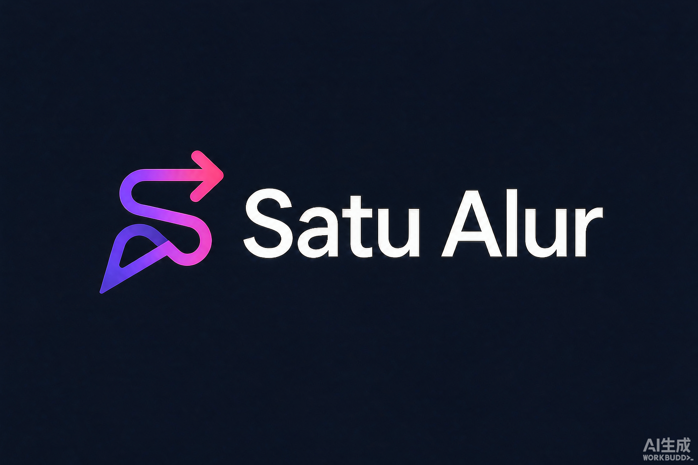

# Satu Alur

<p align="center">
  
</p>

**Satu Alur** — Satu alur lengkap untuk otomasi operasi jasa dengan kecerdasan buatan. Dirancang untuk perusahaan layanan jasa/on-demand di Indonesia.

> Dari permintaan pelanggan sampai laporan keuangan, semua dalam satu alur yang terintegrasi.

## Fitur Utama

- **6 Tahap Alur Jasa Lengkap**: Permintaan → Penawaran → Penugasan → Penyelesaian → Pembukuan → Laporan
- **AI-Powered**: Penawaran otomatis dengan validasi domain, penjelasan laporan keuangan
- **WorkBuddy Cloud Integration**: Auth, Database, Storage, dan LLM API keyless
- **AntiSlop UI Engine**: Design token enforcement, content quality gates, runtime validation
- **Mode Prototype**: Berjalan penuh tanpa backend (data lokal di browser)
- **MCP Connectors**: Siap integrasi WhatsApp (WAPilot) & Email (SMTP)
- **Agent Skill Editor**: User bisa mengubah prompt AI sesuai kebutuhan bisnis

## Tech Stack

- **Frontend**: Vite + Vanilla JavaScript (ES Modules) + AntiSlop Design System
- **Backend**: WorkBuddy Cloud Service (Database, Auth, Storage, LLM API)
- **AI**: WorkBuddy LLM API (keyless, streaming)
- **Language**: Bahasa Indonesia

## Quick Start

### Prerequisites

- Node.js 18+ (disarankan 22+)
- npm atau yarn
- Akun WorkBuddy (untuk cloud features)

### Instalasi

```bash
# Clone repository
git clone https://github.com/username/satu-alur.git
cd satu-alur

# Install dependencies
npm install

# Jalankan mode development
npm run dev
```

Aplikasi akan berjalan di `http://localhost:5173`

### Mode Prototype (Tanpa Cloud)

Secara default aplikasi berjalan dalam mode prototype:
- Semua fitur 6 tahap berfungsi penuh
- AI penawaran & laporan (simulasi streaming)
- Data tersimpan di localStorage browser
- Data tidak persisten antar perangkat/browser

### Aktivasi WorkBuddy Cloud

Untuk mengaktifkan backend cloud (Database, Auth, AI nyata):

1. Pastikan Anda memiliki akun WorkBuddy
2. Jalankan perintah aktivasi (via WorkBuddy AI assistant):
   ```
   "Aktifkan cloud Satu Alur"
   ```
3. Setelah aktivasi berhasil, isi file `src/cloud.config.js`:
   ```javascript
   export const publicConfig = {
     resourceId: 'your-resource-id',
     endpoint: 'https://your-app.workbuddy.link',
     oauthRelayBaseUrl: 'https://oauth.workbuddy.link',
     publishableKey: 'your-publishable-key',
   }
   ```
4. Refresh browser — aplikasi otomatis beralih ke mode cloud

## Struktur Project

```
satu-alur/
├── public/
│   └── assets/          # Brand assets (logo, icon, hero)
│       ├── logo-satu-alur.png
│       ├── icon-satu-alur.png
│       └── hero-banner.png
├── src/
│   ├── ai/              # AI agent (penawaran & penjelasan laporan)
│   │   ├── agent.js
│   │   └── models.js
│   ├── auth/            # Authentication module
│   │   └── auth.js
│   ├── cloud.js         # Cloud SDK initialization
│   ├── cloud.config.js  # Cloud config (user-specific)
│   ├── domain/          # Domain models & validation rules
│   │   ├── models.js
│   │   └── rules.js
│   ├── mock/            # Mock cloud for prototype mode
│   │   └── mock-cloud.js
│   ├── stages/          # 6 stage UI + settings
│   │   ├── request.js
│   │   ├── offer.js
│   │   ├── assign.js
│   │   ├── complete.js
│   │   ├── bookkeeping.js
│   │   ├── report.js
│   │   └── settings.js  # MCP + Agent + Cloud config
│   ├── ui/              # UI components, animations, AntiSlop engine
│   │   ├── app.js
│   │   ├── animations.js
│   │   ├── antislop.js  # Design token & quality enforcement
│   │   └── components.js
│   ├── main.js          # Entry point
│   └── styles.css       # Global styles (dark theme, animations)
├── docs/
│   ├── DATABASE_SCHEMA.md
│   └── API.md
├── scripts/
│   └── setup.js
├── index.html
├── package.json
├── vite.config.js
└── README.md
```

## Database Schema

Lihat [docs/DATABASE_SCHEMA.md](docs/DATABASE_SCHEMA.md) untuk skema lengkap.

## API Documentation

Lihat [docs/API.md](docs/API.md) untuk dokumentasi API.

## Scripts

| Script | Description |
|--------|-------------|
| `npm run dev` | Start development server |
| `npm run build` | Build for production |
| `npm run preview` | Preview production build |
| `npm run setup` | Auto-setup configuration |

## Alur Penggunaan

### 1. Permintaan (Request)
- Input: Nama pelanggan, jenis layanan, lokasi, deskripsi
- Output: Daftar permintaan tersimpan

### 2. Penawaran (Offer) — AI Powered
- Pilih permintaan dari daftar
- AI menghasilkan proposal JSON (scope, harga, terms)
- Domain rules memvalidasi hasil
- Setuju → simpan ke database

### 3. Penugasan (Assignment)
- Pilih penawaran yang disetujui
- Input: Nama pekerja, jadwal
- Output: Daftar penugasan aktif

### 4. Penyelesaian (Completion)
- Pilih penugasan aktif
- Input: Catatan hasil pekerjaan
- Output: Status selesai

### 5. Pembukuan (Bookkeeping)
- Pilih pekerjaan selesai
- Input: Jumlah, kategori (pendapatan/biaya)
- Output: Jurnal + ringkasan laba/rugi

### 6. Laporan (Report) — AI Powered
- Ringkasan keuangan otomatis
- AI menjelaskan laporan dalam bahasa mudah dipahami

### 7. Pengaturan (Settings)
- **MCP Connectors**: Konfigurasi WhatsApp (WAPilot) & Email (SMTP)
- **Agent Skills**: Edit prompt AI, temperature, max tokens, model preference
- **WorkBuddy Cloud**: Endpoint, publishableKey, OAuth relay

## Kontribusi

1. Fork repository
2. Buat branch feature (`git checkout -b feature/nama-fitur`)
3. Commit perubahan (`git commit -m 'Add: nama fitur'`)
4. Push ke branch (`git push origin feature/nama-fitur`)
5. Buat Pull Request

## License

MIT License

## Support

Untuk bantuan teknis atau pertanyaan, buat issue di GitHub repository.
