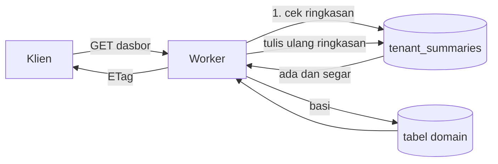
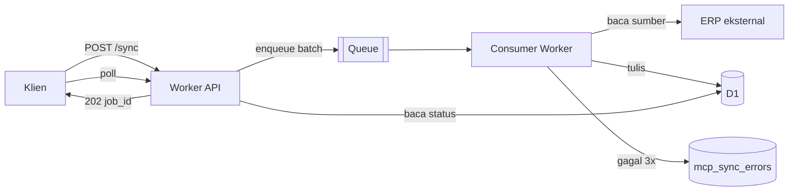
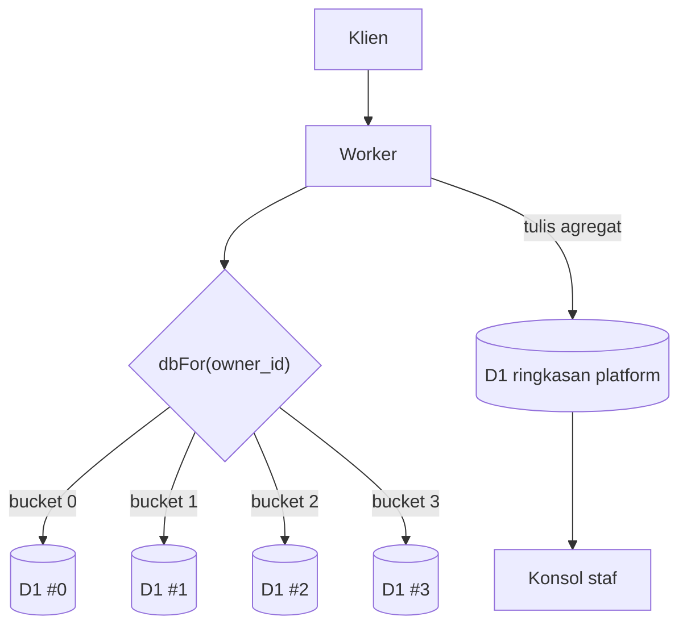
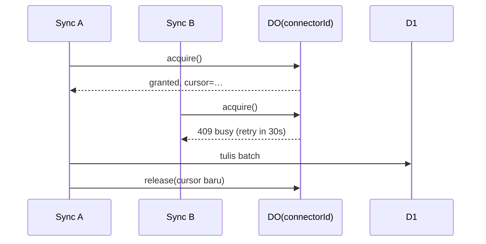
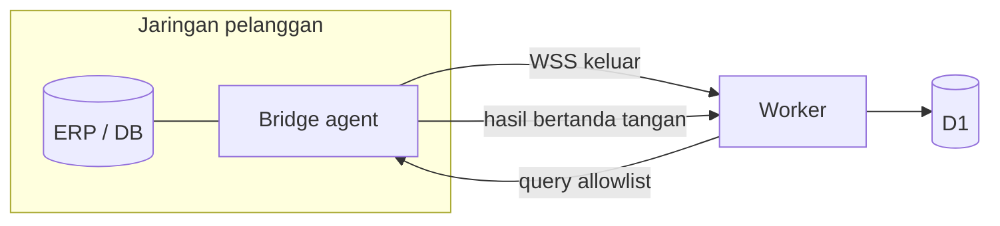

# Arsitektur Skala Besar dan Rencana Jangka Panjang

> Status: Draft untuk ditinjau
> Terakhir diperbarui: 2026-11-02
> Pemilik: Platform Team
> Dokumen terkait: [05_ARCHITECTURE.md](05_ARCHITECTURE.md) (arsitektur hari ini), [08_ROADMAP.md](08_ROADMAP.md) (peta jalan ringkas), [21_BACKEND.md](21_BACKEND.md), [mcp/MCP_SPEC.md](mcp/MCP_SPEC.md), [11_DECISIONS.md](11_DECISIONS.md)

Dokumen ini menjawab dua pertanyaan: **apa yang patah lebih dulu ketika pelanggan bertambah**, dan **apa yang harus dibangun sebelum itu terjadi**. Isinya bukan daftar teknologi yang ingin dipakai, melainkan urutan perubahan yang dipicu oleh angka.

---

## 0. Ringkasan

Sistem hari ini adalah **satu Worker, satu database D1, satu bucket R2, satu binding Workers AI**. Bentuk ini benar untuk tahap sekarang: biaya hampir nol, tidak ada infrastruktur yang perlu dirawat, dan satu orang bisa memahami seluruh sistem dalam satu hari.

Bentuk ini akan patah pada urutan yang bisa diprediksi:

| # | Yang patah lebih dulu | Gejalanya | Diperbaiki di tahap |
|---|----------------------|-----------|---------------------|
| 1 | **Query berat di jalur baca** (dasbor, laporan, penasihat AI) | p95 > 400 ms, kuota baca D1 habis sebelum kuota tulis | 1 |
| 2 | **Pekerjaan panjang di dalam request** (sinkronisasi ERP, fase migrasi) | Worker kehabisan CPU time, request 524, pengguna menutup tab | 2 |
| 3 | **Ukuran database** | satu D1 mendekati batas ukuran; backup dan migrasi skema makin lambat | 3 |
| 4 | **Dua penulis pada satu konektor** | baris ganda di `mcp_external_refs`, sinkronisasi saling menimpa | 4 |
| 5 | **Laporan lintas tahun** | agregasi 12 bulan memakan 5+ detik karena memindai jutaan baris | 5 |
| 6 | **Kedaulatan data** (enterprise minta data di Indonesia) | kontrak gagal karena data harus berada di yurisdiksi tertentu | 6 |

Urutan ini penting: **jangan lompat ke tahap 3 sebelum tahap 1 dan 2 selesai.** Sharding database sebelum ada cache dan antrean hanya memindahkan masalah, bukan menyelesaikannya.

Tiga prinsip yang tidak berubah di semua tahap:

1. **Satu penulis per partisi.** Tidak pernah ada dua jalur tulis ke himpunan data yang sama.
2. **Tabel domain tetap bersih.** Integrasi memakai tabel sisi (`mcp_external_refs`), bukan kolom `external_id` yang bocor ke setiap tabel.
3. **Aturan bisnis satu sumber.** `src/*/rules.js` dipakai Worker, klien, dan mock sekaligus — formulir dan database tidak boleh berbeda pendapat.

---

## 1. Kondisi hari ini (fakta, bukan asumsi)

| Komponen | Implementasi | Batas keras | Kapan menggigit |
|----------|--------------|-------------|-----------------|
| Komputasi | 1 Worker, `worker/index.js` (1.122 baris) + 9 modul (total 4.178 baris) | CPU 30 dtk/request (berbayar), memori 128 MB | Sinkronisasi > ~2.000 baris |
| Aset | `ASSETS` → `dist/` (Vite), `run_worker_first = ["/api/*"]` | — | — |
| Database | 1 D1 `satu-alur-db` (`085c9a7a-…`), migrasi sampai `0009`, ±20 tabel | ±10 GB (berbayar), **satu primary writer** | ±500 tenant aktif, atau fase migrasi besar |
| Objek | R2 `satu-alur-media` | — | — |
| AI | Binding `AI` (Workers AI) | Kuota neuron/bulan | Pemakaian penawaran + laporan harian |
| Jadwal | Cron `*/5 * * * *` (posting sosial tertunda, maks 15 baris/run) | 1 cron = 1 Worker invocation | Ketika ada 5+ pekerjaan terjadwal berbeda |
| Auth | OTP email (mode demo mengembalikan kode), sesi hash 30 hari, Bearer | — | — |
| Multi-tenancy | Kolom `owner_id` di setiap tabel domain, ditegakkan di Worker (tanpa RLS) | — | Ketika satu usaha butuh banyak pengguna |
| `/api/db` generik | Whitelist tabel+kolom, `MAX_LIMIT = 5000`, kuota per pemilik (500 item VAS, 2.000 temuan) | 5.000 baris/permintaan | Agregasi sisi klien di atas 5.000 baris |
| MCP | 6 tabel, 22 rute `/api/mcp/*`, AES-GCM untuk kredensial, dead-letter queue | 500 baris/impor, 100/batch, 20 konektor/tenant | Migrasi > 500 baris sekali jalan |

**Batas yang paling menentukan bukan ukuran, melainkan model tulis D1.** D1 adalah SQLite: satu primary, tulis diserialkan. Semua tenant menulis ke antrean yang sama. Pada beban B2B normal (ratusan tenant, beberapa tulis per menit saat sibuk) ini masih longgar — yang lebih dulu terasa adalah **baca**: dasbor, laporan, dan penasihat AI memindai rentang tanggal berulang kali untuk setiap kali halaman dibuka.

### 1.1 Estimasi kapasitas kasar

Asumsi satu tenant usaha jasa kecil–menengah: 50–200 pekerjaan/bulan, ±1 KB per baris setelah teks dan JSON.

| Komponen | Per tenant / tahun | 300 tenant / 3 tahun |
|----------|--------------------|----------------------|
| `requests` + `offers` + `assignments` + `completions` | ±5.000 baris · ±5 MB | ±1,5 GB |
| `ledger_entries` (2–3 baris per penyelesaian) | ±10.000 baris · ±2 MB | ±1,8 GB |
| `customers`, `leads`, `radar` | ±2.000 baris · ±1 MB | ±0,9 GB |
| `mcp_sync_logs` + `mcp_sync_errors` | ±3.000 baris · ±3 MB | ±2,7 GB |

Kesimpulan: **satu D1 bertahan sampai sekitar 300–500 tenant aktif atau 5–6 GB**, mana yang lebih dulu. Angka ini yang menjadi pemicu tahap 3, bukan tanggal.

---

## 2. Prinsip arsitektur

Delapan aturan yang harus tetap benar setelah sepuluh kali lipat pelanggan:

1. **Satu penulis per partisi.** Setiap himpunan data punya tepat satu jalur tulis. Sharding, antrean, dan Durable Object semuanya ada untuk menjaga aturan ini, bukan melanggarnya.
2. **Klien tidak pernah menyentuh database.** Semua lewat Worker. Ini yang membuat whitelist kolom, `owner_id`, dan validasi server punya arti.
3. **Integrasi di tepi, bukan di inti.** Data eksternal masuk lewat `mcp_*`, dipetakan, lalu ditulis ke tabel domain memakai aturan yang sama seperti input pengguna.
4. **Uang integer, waktu ISO-8601 UTC.** Rupiah tanpa desimal; waktu disimpan UTC, diformat di klien.
5. **Aturan satu sumber.** Modul `rules.js` per domain; Worker mengimpor modul yang sama dengan peramban.
6. **Idempoten di batas sistem.** Setiap tulis dari luar punya kunci alami; pengulangan tidak menggandakan.
7. **Baca boleh diduplikasi, tulis tidak.** Ringkasan/materialized view boleh basi beberapa menit; saldo tidak boleh.
8. **Setiap integrasi punya jalur mati dan jalur pulih.** Dead letter tanpa replay hanyalah tempat sampah.

---

## 3. Tangga skalabilitas

Enam tahap. Setiap tahap punya **pemicu** (angka, bukan tanggal), **perubahan**, **biaya tambahan**, dan **yang dibeli**.

```mermaid
flowchart LR
  S0["Tahap 0<br/>1 Worker · 1 D1<br/>(sekarang)"]
  S1["Tahap 1<br/>Cache & ringkasan"]
  S2["Tahap 2<br/>Antrean & pekerjaan async"]
  S3["Tahap 3<br/>Sharding per bucket"]
  S4["Tahap 4<br/>Durable Object per konektor"]
  S5["Tahap 5<br/>Pisah jalur analitik"]
  S6["Tahap 6<br/>Regional & kedaulatan data"]
  S0 -->|"p95 baca > 400 ms"| S1
  S1 -->|"CPU > 10 dtk / migrasi > 2.000 baris"| S2
  S2 -->|"DB > 6 GB / tulis p95 > 200 ms"| S3
  S3 -->|"sinkronisasi bersamaan / insiden dobel"| S4
  S4 -->|"laporan > 5 dtk"| S5
  S5 -->|"permintaan enterprise"| S6
```

### Tahap 0 — Sekarang

Satu Worker, satu D1. **Tidak ada yang perlu diubah** sampai pemicu pertama tercapai. Yang dilakukan di tahap ini hanyalah **mengukur**: kalau pemicu tidak diukur, tahap berikutnya dipicu oleh panik, bukan data.

Yang harus ada sekarang juga (murah, mencegah kerja ulang):

- `request_id` di setiap log, diteruskan ke respons (`X-Request-Id`).
- Penghitung durasi per rute (`/api/db`, `/api/llm/*`, `/api/mcp/*/sync`).
- Penghitung baris dibaca/ditulis per tenant per hari (bisa diturunkan dari log).
- Uji beban sintetis bulanan: 50 tenant virtual, 1.000 request campuran.

### Tahap 1 — Cache dan ringkasan

**Pemicu:** p95 `/api/db` > 400 ms, atau baca D1 > 60% kuota bulanan.

**Perubahan:**

1. **Ringkasan materialized** untuk dasbor dan laporan: tabel `tenant_summaries` (satu baris per `owner_id` per periode) yang diperbarui saat ada tulis yang relevan, bukan saat halaman dibuka. Dasbor berhenti memindai `ledger_entries`.
2. **Cache HTTP** untuk respons yang aman di-cache: `/api/llm/models`, `/api/mcp/schema`, aset statis (sudah otomatis lewat `ASSETS`).
3. **ETag + `If-None-Match`** pada endpoint daftar; 304 lebih murah daripada query.
4. **Indeks komposit** yang mengikuti pola query nyata: `(owner_id, created_at)`, `(owner_id, status)`, `(owner_id, period_start)`.

**Biaya:** nol tambahan (KV/Cache API dalam paket). **Yang dibeli:** 5–20× penurunan baca untuk halaman yang paling sering dibuka.

**Jangan lakukan:** cache di sisi klien untuk angka uang. Ringkasan yang basi 30 detik dapat diterima untuk grafik tren; tidak untuk saldo.

### Tahap 2 — Antrean dan pekerjaan asinkron

**Pemicu:** ada pekerjaan yang memakan CPU > 10 detik (fase migrasi > 2.000 baris, sinkronisasi ERP dengan banyak halaman), atau request mulai kena 524.

**Perubahan:**

1. **Cloudflare Queues** untuk tiga jenis pekerjaan: `mcp.sync`, `mcp.migration.phase`, `report.generate`.
2. Endpoint memulai pekerjaan lalu **segera** mengembalikan `202 { job_id }`; klien memantau lewat `GET /api/jobs/:id` atau polling status yang sudah ada (`mcp_sync_logs`, `mcp_migrations.phases`).
3. **Consumer dengan batas waktu sendiri**: satu pesan = satu batch 100 baris, sehingga kegagalan tidak mengulang seluruh fase.
4. **Retry berjenjang** (3× dengan backoff) lalu masuk dead letter — memakai `mcp_sync_errors` yang sudah ada.
5. **Cron fan-out**: satu cron per 5 menit memecah pekerjaan terjadwal menjadi pesan, bukan mengerjakannya sendiri.

**Biaya:** Queue berbayar per operasi (kecil, sebanding dengan jumlah baris yang dipindahkan). **Yang dibeli:** migrasi 100.000 baris berjalan tanpa satu pun request panjang; pengguna boleh menutup tab.

**Detail penting:** pekerjaan async harus **idempoten per batch**, karena Queue menjamin *at-least-once*. `mcp_external_refs` sudah memberi kunci alami — inilah alasan tabel itu dibuat sejak awal.

### Tahap 3 — Sharding per bucket

**Pemicu:** database > 6 GB, tulis p95 > 200 ms, atau backup/migrasi skema mulai mengganggu jam kerja.

**Perubahan:**

1. **Kunci shard = hash(`owner_id`) % N**, dengan N = 4 sebagai awalan. Bucket disimpan di tabel `tenant_buckets` (bukan dihitung ulang setiap request) supaya pemindahan tenant tidak mengubah alamatnya secara diam-diam.
2. **Router di Worker**: satu fungsi `dbFor(ownerId)` mengembalikan binding D1 yang tepat. Semua handler memakai router ini; tidak ada handler yang menyebut `env.DB` langsung.
3. **Binding statis, bukan dinamis.** Cloudflare Worker tidak bisa memilih database dari string sembarang; `env.DB_0 … env.DB_3` dideklarasikan di `wrangler.toml` dan router memilih salah satunya.
4. **Data lintas bucket hanya untuk konsol staf**: laporan platform (jumlah tenant, pendapatan agregat) dijalankan sebagai pekerjaan terjadwal yang menulis ke satu database ringkasan, bukan query gabungan saat request.

**Biaya:** biaya dasar D1 × N, ditambah kerumitan operasional (N kali migrasi, N kali backup). **Yang dibeli:** plafon ukuran dan tulis naik linear; satu tenant besar tidak bisa memperlambat tenant lain.

**Aturan yang tidak boleh dilanggar:** satu tenant **selamanya** di satu bucket. Memindahkan tenant antar-bucket adalah operasi offline dengan jendela pemeliharaan, bukan sesuatu yang terjadi saat request.

### Tahap 4 — Durable Object per konektor

**Pemicu:** sinkronisasi pertama yang berjalan bersamaan pada konektor yang sama, atau satu insiden baris ganda.

**Perubahan:**

1. **Satu Durable Object per konektor** (`idFromName(connectorId)`), berperan sebagai **kunci** dan **koordinator**: hanya satu sinkronisasi/migrasi per konektor pada satu waktu, sisanya mengantre atau ditolak dengan `409`.
2. DO juga menyimpan **kursornya** (`last_sync_at`, `last_cursor`), sehingga dua instance Worker tidak bisa memulai dari titik yang sama.
3. **Progress realtime** migrasi lewat WebSocket dari DO yang sama — menggantikan polling.

**Biaya:** DO berbayar per request dan per GB-detik, tetapi satu DO per konektor aktif sangat kecil. **Yang dibeli:** kelas bug yang hilang seluruhnya — balapan tulis tidak lagi mungkin secara desain.

**Catatan:** ini juga tempat yang tepat untuk **circuit breaker** per konektor: setelah 5 kegagalan berturut, DO menolak sinkronisasi otomatis dan menandai konektor `degraded` sampai ada tindakan manual.

### Tahap 5 — Pisah jalur analitik

**Pemicu:** laporan 12 bulan > 5 detik, atau penasihat AI mulai memindai tabel mentah.

**Perubahan:**

1. **Tabel fakta agregat** (`fact_daily`, `fact_monthly`) per tenant: satu baris per hari/bulan, ditulis saat transaksi terjadi. Laporan membaca puluhan baris, bukan ratusan ribu.
2. **Ekspor ke R2** (Parquet/NDJSON per bulan) untuk analitik jangka panjang dan retensi arsip; D1 menyimpan 24 bulan terakhir saja.
3. **Pencarian** memakai FTS5 D1 untuk pelanggan/pekerjaan; bila perlu pencarian semantik, Vectorize sebagai tambahan, bukan pengganti.

**Biaya:** kecil (R2 murah). **Yang dibeli:** laporan tidak lagi tumbuh linear terhadap umur tenant — ini yang membuat tenant 5 tahun tetap secepat tenant baru.

### Tahap 6 — Regional dan kedaulatan data

**Pemicu:** ada calon pelanggan yang secara kontrak mensyaratkan data berada di yurisdiksi tertentu, atau latensi lintas kawasan menjadi keluhan.

**Perubahan:**

1. **Satu deployment per kawasan** (`id`, `sg`), masing-masing dengan D1 dan R2 sendiri. Tenant didaftarkan ke kawasan saat onboarding; tidak ada replikasi aktif-aktif.
2. **DNS/route per kawasan** (`id.satualur.app`), bukan satu domain dengan pemilihan dinamis.
3. **Read replication D1** untuk laporan lintas kawasan bila diperlukan (baca saja; tulis tetap ke primary kawasan).

**Biaya:** berlipat per kawasan, dan setiap kawasan butuh pemantauan sendiri. **Yang dibeli:** kepatuhan, bukan performa. **Jangan lakukan sebelum ada permintaan kontraktual.**

---

## 4. Evolusi multi-tenancy

Hari ini `owner_id` = id pengguna. Itu berarti **satu pengguna = satu usaha**. Begitu ada usaha dengan dua orang (pemilik + admin + staf lapangan), model ini patah — bukan pada performa, melainkan pada izin.

### 4.1 Jalur migrasi ke organisasi

| Langkah | Perubahan skema | Perubahan kode | Titik balik |
|---------|-----------------|----------------|-------------|
| 1 | Tambah `orgs`, `org_members`; `owner_id` tetap | Tidak ada | Hapus 2 tabel |
| 2 | Tambah `org_id` (nullable) di tabel domain | Dual-write: isi `org_id` dari `owner_id` | Abaikan `org_id` |
| 3 | Backfill `org_id` untuk semua baris | Baca memakai `org_id`, tulis keduanya | Kembali baca `owner_id` |
| 4 | `org_id` NOT NULL | Hapus jalur tulis `owner_id` | Butuh restore backup |
| 5 | Hapus `owner_id` dari tabel domain | Hapus sisa kode | Selesai |

Setiap langkah adalah rilis terpisah. Langkah 4 tidak boleh digabung dengan langkah 3 — kalau digabung, rollback menjadi tidak mungkin.

### 4.2 Peran

| Peran | Baca | Tulis domain | Kelola konektor | Kelola anggota | Lihat keuangan |
|-------|------|--------------|-----------------|----------------|----------------|
| Pemilik | ✓ | ✓ | ✓ | ✓ | ✓ |
| Admin | ✓ | ✓ | ✓ | – | ✓ |
| Staf | ✓ | ✓ (terbatas) | – | – | – |
| Peninjau | ✓ | – | – | – | ✓ |

Ditegakkan di Worker pada satu tempat (`requireRole(orgId, role)`), bukan tersebar di handler. **Uji invarian**: setiap tabel domain punya tepat satu kolom tenant, dan setiap rute `/api/db` menambahkannya — dijaga oleh tes, bukan oleh disiplin.

---

## 5. Lapisan integrasi sebagai parit jangka panjang

Fitur bisa ditiru dalam sebulan. **Integrasi tidak.** Setelah sebuah perusahaan memetakan 40 kolom ERP-nya, memindahkan data historisnya, dan menjalankan dua sistem paralel selama tiga bulan, biaya pindah ke pesaing adalah mengulang semua itu. Inilah aset yang sebenarnya.

### 5.1 Evolusi kapabilitas

| Kapabilitas | v1 (sekarang) | v2 | v3 | v4 |
|-------------|---------------|----|----|----|
| REST API (tarik/tulis) | ✓ | ✓ | ✓ | ✓ |
| File impor (CSV/JSON) | ✓ (500 baris/permintaan) | ✓ (streaming) | ✓ | ✓ |
| Webhook masuk (HMAC) | ✓ | ✓ | ✓ | ✓ |
| Database langsung | dilaporkan `BRIDGE_REQUIRED` | **bridge agent** | ✓ | ✓ |
| Sinkronisasi terjadwal | manual | Cron + Queue | ✓ | ✓ |
| Pemetaan otomatis | saran heuristik | saran + pratinjau 100 baris | pembelajaran dari pemetaan yang disetujui | ✓ |
| Konektor pihak ketiga | – | – | **SDK + direktori** | marketplace berbayar |
| Aliran dua arah peristiwa | – | – | – | **event streaming** |
| Kunci per konektor | – | – | DO (tahap 4) | DO + antrean |

### 5.2 Bridge agent (v2) — kenapa perlu dan bagaimana

Worker tidak bisa membuka koneksi TCP mentah, jadi konektor "database langsung" tidak mungkin dijalankan di dalam Worker. Menyuruh pelanggan membuka port database ke internet adalah ide buruk dan sering dilarang kebijakan TI mereka.

**Bridge agent** adalah program kecil (Go atau Node, satu binary) yang dipasang pelanggan **di dalam jaringan mereka**:

- Membuka koneksi **keluar** (WebSocket aman) ke Worker — tidak ada port masuk yang dibuka.
- Didaftarkan dengan token sekali pakai; identitasnya diikat ke satu `connector_id`.
- Hanya menjalankan **query yang sudah disetujui** (allowlist per konektor, bukan SQL bebas).
- Menandatangani setiap respons; Worker menolak respons tanpa tanda tangan valid.
- Melaporkan versi dan kesehatan; konektor ditandai `degraded` bila diam > 5 menit.

Ini bukan pekerjaan kecil (estimasi 6–10 minggu untuk versi yang layak produksi), dan **tidak perlu dibangun sebelum ada dua pelanggan yang memintanya secara tertulis**.

### 5.3 Keandalan yang sudah ada dan yang kurang

| Jaminan | Status | Catatan |
|---------|--------|---------|
| Idempoten (upsert) | ✓ | `mcp_external_refs` unik per `(connector_id, entity, external_id)` |
| Replay dari dead letter | ✓ | `mcp_sync_errors` menyimpan baris sumber mentah |
| Rahasia tidak pernah dikembalikan | ✓ | `redactConnector()` |
| Kunci per konektor | ✗ | tahap 4 |
| Circuit breaker | ✗ | tahap 4 |
| Rotasi kunci enkripsi | ✗ | perlu `key_version` per baris (lihat §6.2) |
| Sinkronisasi terjadwal | ✗ | tahap 2 |

---

## 6. Observabilitas, keamanan, dan pemulihan bencana

### 6.1 Observabilitas

Tiga tingkat, dari yang paling murah:

1. **Log terstruktur** (JSON) dengan `request_id`, `route`, `owner_id`, `duration_ms`, `rows`, `status`. Tanpa PII: nomor telepon dipotong, isi pesan tidak dicatat.
2. **Metrik** lewat Workers Analytics Engine: `db.reads`, `db.writes`, `llm.tokens`, `mcp.sync.rows`, `mcp.sync.failures`, per tenant per hari.
3. **Alert** pada lima sinyal saja — lebih dari itu akan diabaikan:
   - tingkat 5xx > 1% selama 5 menit;
   - kegagalan sinkronisasi > 20% selama 1 jam;
   - dead letter bertambah > 100 baris/jam;
   - galat tulis D1 > 0 dalam 10 menit;
   - p95 `/api/llm/chat` > 30 detik.

**Yang tidak dibangun:** penelusuran terdistribusi penuh. Dengan satu Worker dan satu database, `request_id` + durasi per tahap sudah cukup untuk menemukan penyebab.

### 6.2 Keamanan

| Area | Hari ini | Yang ditambahkan |
|------|----------|------------------|
| Kredensial konektor | AES-GCM dengan `MCP_ENCRYPTION_KEY`; jatuh ke `plain:` base64 bila kunci tidak diset | **Wajibkan kunci di produksi** — tolak simpan kredensial bila tidak ada; `key_version` per baris untuk rotasi |
| Token sesi | Hash SHA-256, 30 hari | Rotasi token saat perubahan peran; daftar sesi aktif |
| Rate limit | Hanya OTP per email | Per token: `/api/llm/*` (paling mahal), `/api/mcp/*/sync`, `/api/auth/*` |
| Audit | Tidak ada | Tabel `audit_log` untuk: login staf, ubah konektor, jalankan migrasi, rollback, ekspor data |
| CSP | Belum | `default-src 'self'`; longgarkan hanya untuk yang benar-benar perlu |

**Catatan penting untuk rilis berikutnya:** `MCP_ENCRYPTION_KEY` belum tentu ada di lingkungan produksi. Tanpa kunci, kredensial ERP tersimpan sebagai base64 — bisa dibaca siapa pun yang memegang akses baca D1. Ini harus ditutup sebelum konektor pertama dipakai dengan kredensial asli.

### 6.3 Pemulihan bencana

| Aspek | Target awal | Target matang |
|-------|-------------|---------------|
| RPO (data hilang maksimal) | 24 jam | 1 jam |
| RTO (layanan kembali) | 4 jam | 1 jam |
| Backup | `wrangler d1 export` harian → R2, retensi 30 hari | + ekspor per jam untuk tabel transaksi |
| Uji restore | Sekali per kuartal, ke D1 terpisah | Bulanan, otomatis |
| Rollback kode | `wrangler rollback` (versi sebelumnya) | Sama + migrasi yang dapat dibalik |

Aturan migrasi: **setiap migrasi harus bisa dijalankan pada database yang sudah berisi data produksi**, dan penambahan kolom harus nullable atau punya default. Menghapus kolom selalu rilis terpisah, setelah kode berhenti membacanya.

---

## 7. Rencana jangka panjang

Fase, bukan tanggal. Setiap fase punya kriteria selesai yang bisa diperiksa.

| Fase | Fokus arsitektur | Tim | Risiko utama | Kriteria selesai |
|------|------------------|-----|--------------|------------------|
| **F0 — Fondasi** (sekarang) | 1 Worker + 1 D1 + MCP v1 | 1–2 orang | Fitur menumpuk sebelum diukur | Pemicu tahap 1–3 terpasang dan terlihat di dasbor internal |
| **F1 — Tahan beban** | Cache, ringkasan, antrean (tahap 1–2) | 2–3 orang | Ringkasan tidak konsisten dengan tabel sumber | Dasbor < 300 ms p95; migrasi 100.000 baris tanpa request panjang |
| **F2 — Multi-tenant** | Organisasi, peran, sharding (tahap 3, §4) | 3–4 orang | Migrasi `org_id` setengah jalan | 1 organisasi bisa punya 5 pengguna; 500 tenant pada N bucket |
| **F3 — Platform integrasi** | Bridge agent, SDK konektor, kunci per konektor (tahap 4, §5) | 4–5 orang | Bridge agent jadi beban dukungan | Dua pelanggan menjalankan bridge agent di produksi |
| **F4 — Skala & kemitraan** | Analitik terpisah, direktori konektor (tahap 5) | 5–7 orang | Biaya infrastruktur naik lebih cepat dari pendapatan | Laporan 12 bulan < 2 dtk pada tenant 5 tahun |
| **F5 — Enterprise & kawasan** | Regional, kepatuhan, SLA (tahap 6) | 7+ orang | Satu kawasan jadi pusat biaya | Satu kontrak mensyaratkan kawasan tertentu terpenuhi |

**Urutan tim mengikuti arsitektur, bukan sebaliknya.** Menambah orang sebelum ada antrean hanya menambah orang yang menunggu request panjang selesai.

### 7.1 Yang secara eksplisit tidak dilakukan

| Tidak dilakukan | Alasan | Kapan ditinjau ulang |
|-----------------|--------|----------------------|
| Mikroservis | Satu Worker sudah memisahkan modul dengan jelas; batas jaringan menambah latensi dan kegagalan tanpa manfaat pada skala ini | > 15 engineer, atau ada tim yang butuh siklus rilis sendiri |
| Kubernetes | Tidak ada proses yang berjalan terus-menerus | Bila bridge agent perlu dijalankan sebagai layanan terkelola |
| API gateway terpisah | Worker sudah menjadi gateway | Bila perlu kebijakan lintas layanan |
| GraphQL | `/api/db` + endpoint domain sudah cukup; GraphQL menambah permukaan serangan dan biaya | Bila ada 3+ klien berbeda (mobile, partner) |
| Satu database per tenant | 500 database kecil lebih mahal dan lebih sulit dirawat daripada 4 bucket | Bila ada tenant yang mau membayar isolasi penuh |
| Event sourcing | Kompleksitas tinggi; audit log biasa cukup | Bila perlu rekonstruksi state historis |
| Aktif-aktif multi-kawasan | Konflik tulis pada SQLite tidak sepadan | Bila RTO < 5 menit menjadi syarat kontrak |

---

## 8. Keputusan yang perlu diambil sekarang

Lima keputusan ini menentukan bentuk semua pekerjaan berikutnya. Masing-masing layak menjadi ADR di [11_DECISIONS.md](11_DECISIONS.md).

| ID usulan | Keputusan | Pilihan | Rekomendasi |
|-----------|-----------|---------|-------------|
| ADR-012 | Kunci sharding | `hash(owner_id) % N` / rentang id / tabel eksplisit | **Tabel eksplisit `tenant_buckets`**, diisi saat onboarding; hash hanya untuk default |
| ADR-013 | Model tenant | `owner_id` selamanya / `org_id` bertahap | **`org_id` bertahap** sesuai §4.1 |
| ADR-014 | Pekerjaan async | Queue / Cron saja / DO alarm | **Queue untuk migrasi, Cron untuk jadwal**; DO hanya untuk kunci |
| ADR-015 | Konektor DB langsung | Bridge agent / VPN pelanggan / tidak mendukung | **Bridge agent**, ditunda sampai ada permintaan tertulis |
| ADR-016 | Observabilitas | Log saja / Analytics Engine / vendor APM | **Log + Analytics Engine**; APM ditinjau di F3 |

---

## 9. Cara memakai dokumen ini

- **Sebelum menambah fitur besar**, periksa §1: apakah fitur itu mendorong salah satu pemicu lebih dekat?
- **Sebelum menambah tabel**, periksa §2 butir 4 dan §4: kolom tenant mana yang dipakai, dan apakah tabel ini akan ikut ter-shard.
- **Sebelum menambah integrasi**, periksa §5.3: jaminan mana yang belum ada, dan apakah integrasi ini masih aman tanpanya.
- **Setiap kuartal**, jalankan uji beban sintetis dan perbarui §1.1 dengan angka nyata.

Dokumen ini sengaja menyebut angka yang bisa salah alih-alih prinsip yang selalu benar. Bila angka di §1.1 terbukti keliru setelah pengukuran, perbaiki angkanya — jangan hapus analisisnya.
