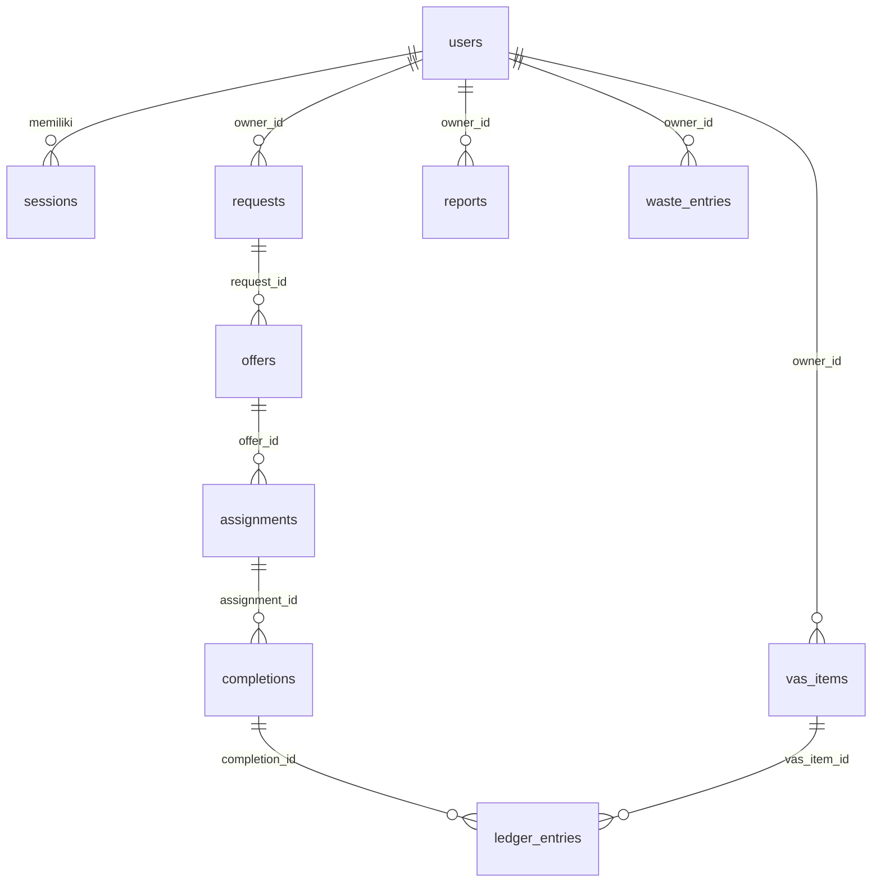

# Skema Database (Cloudflare D1)

> Status: Draft
> Terakhir diperbarui: 2026-10-28
> Pemilik: _TBD_

Skema D1 (SQLite) untuk database `satu-alur-db`. Sumber kebenaran: `migrations/0001_init.sql`. Dokumen ini menggantikan isi [DATABASE_SCHEMA.md](DATABASE_SCHEMA.md) (desain lama WorkBuddy/PostgreSQL).

## Perbedaan dari Desain PostgreSQL

| Aspek | PostgreSQL (lama) | D1 / SQLite (baru) |
|-------|-------------------|--------------------|
| Kunci utama | `BIGINT GENERATED ALWAYS AS IDENTITY` | `INTEGER PRIMARY KEY AUTOINCREMENT` |
| `owner_id` | `DEFAULT auth.uid()` | `TEXT NOT NULL`, diisi Worker dari sesi |
| Isolasi data | Row Level Security | Tidak ada RLS; Worker menambahkan `owner_id = ?` pada setiap query ([21_BACKEND.md](21_BACKEND.md)) |
| Waktu | `TIMESTAMPTZ`, `DATE` | `TEXT` ISO 8601 UTC, default `strftime('%Y-%m-%dT%H:%M:%fZ','now')` |
| JSON | `JSONB` | `TEXT` berisi JSON (di-serialize/parse oleh Worker) |
| Array | `TEXT[]` (`photos_path`) | `TEXT` berisi JSON array |
| `NUMERIC` | presisi tetap | afinitas `NUMERIC` SQLite (bukan desimal presisi tetap) |

## Tabel Autentikasi

Tidak dapat diakses lewat `POST /api/db`.

### users

| Kolom | Tipe | Catatan |
|-------|------|---------|
| `id` | TEXT PK | UUID |
| `email` | TEXT NOT NULL UNIQUE | huruf kecil |
| `name` | TEXT | bawaan: bagian email sebelum `@` |
| `created_at` | TEXT NOT NULL | |

### sessions

| Kolom | Tipe | Catatan |
|-------|------|---------|
| `token_hash` | TEXT PK | SHA-256 hex dari bearer token |
| `user_id` | TEXT NOT NULL | FK `users(id)` ON DELETE CASCADE |
| `expires_at` | TEXT NOT NULL | 30 hari sejak dibuat |
| `created_at` | TEXT NOT NULL | |
| `is_staff` | INTEGER NOT NULL DEFAULT 0 | 1 = dibuat `POST /api/auth/staff-login` (migrasi 0007); satu-satunya sumber hak admin |

Indeks: `idx_sessions_user_id`, `idx_sessions_expires_at`.

### staff_accounts

Akun staf Kantor Satu Alur (migrasi 0007). Dikelola hanya lewat `npm run staff`; tidak pernah ada di whitelist `/api/db`.

| Kolom | Tipe | Catatan |
|-------|------|---------|
| `id` | INTEGER PK | |
| `username` | TEXT NOT NULL UNIQUE | `[a-z0-9._-]{3,32}` |
| `password_hash` | TEXT NOT NULL | `pbkdf2-sha256$<iterasi>$<salt>$<hash>` |
| `active` | INTEGER NOT NULL DEFAULT 1 | 0 = dinonaktifkan |
| `failed_attempts` | INTEGER NOT NULL DEFAULT 0 | direset saat login berhasil atau saat terkunci |
| `locked_until` | TEXT | terkunci 15 menit setelah 5 kali salah |
| `last_login_at` | TEXT | |
| `created_at` | TEXT NOT NULL | |

### user_flags

Atribut per pengguna yang dibaca `authenticate` pada setiap permintaan. Baris dibuat saat pengguna pertama kali diberi flag; tidak adanya baris berarti nilai bawaan (`suspended = 0`, `plan = 'sole'`).

| Kolom | Tipe | Catatan |
|-------|------|---------|
| `user_id` | TEXT PK | FK → `users(id)` ON DELETE CASCADE |
| `suspended` | INTEGER NOT NULL DEFAULT 0 | CHECK 0/1 |
| `reason` | TEXT NOT NULL DEFAULT `''` | alasan penangguhan, tampil ke pengguna |
| `plan` | TEXT NOT NULL DEFAULT `'sole'` | **Tier langganan**: `sole`, `ukm`, `enterprise` (migrasi `0010_user_plan.sql`). Enum ditegakkan di `src/business/plan-access.js`, bukan CHECK constraint, mengikuti konvensi tabel domain |
| `updated_at` | TEXT NOT NULL | |
| `updated_by` | TEXT | staf yang mengubah, bila ada |

**Mengapa tier ada di sini, bukan di `users`:** tabel ini sudah menjadi tempat atribut per pengguna yang dibaca jalur autentikasi, sehingga `authenticate` tidak perlu join tambahan. `plan` menentukan fitur mana yang terbuka — saat ini hanya `erpIntegration` yang butuh `enterprise`; fitur yang tidak terdaftar di `FEATURES` terbuka untuk semua tier, sehingga menutup fitur selalu keputusan sadar.

Akun demo diselaraskan pada setiap `demo-login` (`plan = skala akun`), jadi tiga akun demo Enterprise selalu bisa membuka integrasi ERP.

### otp_codes

| Kolom | Tipe | Catatan |
|-------|------|---------|
| `id` | TEXT PK | dipakai sebagai `verificationId` |
| `email` | TEXT NOT NULL | |
| `code_hash` | TEXT NOT NULL | SHA-256 hex dari `id:kode` |
| `attempts` | INTEGER NOT NULL DEFAULT 0 | maks 5 |
| `expires_at` | TEXT NOT NULL | 10 menit |
| `created_at` | TEXT NOT NULL | |

Indeks: `idx_otp_codes_email`. Baris kedaluwarsa dibersihkan saat `send-otp`.

## Tabel Domain

Semua tabel domain memiliki `owner_id TEXT NOT NULL` (indeks `idx_<tabel>_owner_id`) dan `created_at`. Kolom `id` dan `owner_id` tidak dapat diisi/diubah klien.

### requests

| Kolom | Tipe | Catatan |
|-------|------|---------|
| `id` | INTEGER PK AUTOINCREMENT | |
| `owner_id` | TEXT NOT NULL | |
| `customer_name` | TEXT NOT NULL | |
| `service_type` | TEXT NOT NULL | |
| `location` | TEXT | |
| `description` | TEXT | |
| `status` | TEXT NOT NULL DEFAULT `'draft'` | |
| `requested_at` | TEXT | Jadwal yang diminta klien (ISO); migrasi 0003 |
| `created_at` | TEXT NOT NULL | |

Catatan: tidak ada kolom `phone`, padahal formulir Permintaan mengirimkannya (R-015 di [10_RISK_REGISTER.md](10_RISK_REGISTER.md)).

### offers

| Kolom | Tipe | Catatan |
|-------|------|---------|
| `id` | INTEGER PK AUTOINCREMENT | |
| `owner_id` | TEXT NOT NULL | |
| `request_id` | INTEGER NOT NULL | FK `requests(id)` |
| `ai_proposal_json` | TEXT | JSON |
| `validated_price` | NUMERIC | |
| `validated_scope` | TEXT | |
| `status` | TEXT NOT NULL DEFAULT `'draft'` | |
| `created_at` | TEXT NOT NULL | |

### assignments

| Kolom | Tipe | Catatan |
|-------|------|---------|
| `id` | INTEGER PK AUTOINCREMENT | |
| `owner_id` | TEXT NOT NULL | |
| `offer_id` | INTEGER NOT NULL | FK `offers(id)` |
| `worker_name` | TEXT | |
| `scheduled_at` | TEXT | ISO 8601 |
| `status` | TEXT NOT NULL DEFAULT `'pending'` | |
| `created_at` | TEXT NOT NULL | |

### workers

| Kolom | Tipe | Catatan |
|-------|------|---------|
| `id` | INTEGER PK AUTOINCREMENT | |
| `owner_id` | TEXT NOT NULL | |
| `name` | TEXT NOT NULL | |
| `phone` | TEXT | |
| `address` | TEXT | |
| `skills` | TEXT | JSON array kunci keahlian, mis. `["ac","cleaning"]` |
| `lat` | REAL | Dari geocode(); boleh NULL |
| `lng` | REAL | Dari geocode(); boleh NULL |
| `zone` | TEXT | Dari geocode(); boleh NULL |
| `status` | TEXT NOT NULL DEFAULT `'active'` | `active` \| `inactive` |
| `created_at` | TEXT NOT NULL | |

### assignment_workers

Satu penugasan, banyak petugas.

| Kolom | Tipe | Catatan |
|-------|------|---------|
| `id` | INTEGER PK AUTOINCREMENT | |
| `owner_id` | TEXT NOT NULL | |
| `assignment_id` | INTEGER NOT NULL | FK `assignments(id)` |
| `worker_id` | INTEGER NOT NULL | FK `workers(id)` |
| `created_at` | TEXT NOT NULL | |

Unik pada (`assignment_id`, `worker_id`).

### completions

| Kolom | Tipe | Catatan |
|-------|------|---------|
| `id` | INTEGER PK AUTOINCREMENT | |
| `owner_id` | TEXT NOT NULL | |
| `assignment_id` | INTEGER NOT NULL | FK `assignments(id)` |
| `notes` | TEXT | |
| `photos_path` | TEXT | JSON array string; belum dipakai UI |
| `status` | TEXT NOT NULL DEFAULT `'pending'` | |
| `completed_at` | TEXT | |
| `created_at` | TEXT NOT NULL | |

### ledger_entries

| Kolom | Tipe | Catatan |
|-------|------|---------|
| `id` | INTEGER PK AUTOINCREMENT | |
| `owner_id` | TEXT NOT NULL | |
| `completion_id` | INTEGER NOT NULL | FK `completions(id)` |
| `vas_item_id` | INTEGER | Referensi `vas_items(id)` divalidasi API beserta kepemilikannya; `NULL` = pendapatan jasa biasa. Ditambahkan `0008_pendapatan.sql` |
| `amount` | NUMERIC NOT NULL | |
| `category` | TEXT NOT NULL | lihat nilai di bawah |
| `status` | TEXT NOT NULL DEFAULT `'pending'` | |
| `posted_at` | TEXT | |
| `created_at` | TEXT NOT NULL | |

### reports

| Kolom | Tipe | Catatan |
|-------|------|---------|
| `id` | INTEGER PK AUTOINCREMENT | |
| `owner_id` | TEXT NOT NULL | |
| `period_start` | TEXT NOT NULL | tanggal |
| `period_end` | TEXT NOT NULL | tanggal |
| `summary_json` | TEXT | JSON |
| `explanation_html` | TEXT | |
| `status` | TEXT NOT NULL DEFAULT `'draft'` | |
| `created_at` | TEXT NOT NULL | |

## Nilai Enum (diberlakukan di aplikasi, bukan CHECK constraint)

| Entitas | Nilai |
|---------|-------|
| requests.status | `draft`, `submitted` |
| offers.status | `draft`, `pending_approval`, `approved`, `rejected` |
| assignments.status | `pending`, `assigned`, `in_progress`, `done` (kode di `domain/models.js` tidak mencantumkan `done`, tetapi stage Penyelesaian memakainya) |
| completions.status | `pending`, `done`, `issue` |
| ledger_entries.status | `pending`, `posted` |
| ledger_entries.category | `pendapatan`, `biaya_tenaga`, `biaya_bahan`, `biaya_transport`, `biaya_lain` |
| reports.status | `draft`, `final` |
| vas_items.category | `perawatan`, `perlindungan`, `peningkatan`, `kecepatan`, `paket`, `lain` — **juga** CHECK constraint |
| vas_items.status | `active`, `draft`, `retired` — **juga** CHECK constraint |
| waste_entries.stream | `waktu`, `perjalanan`, `bahan`, `pengerjaan_ulang`, `air_kimia` — **juga** CHECK constraint |
| waste_entries.status | `open`, `progress`, `done` — **juga** CHECK constraint |

Nilai `vas_items` dan `waste_entries` berasal dari satu sumber di `src/pendapatan/rules.js` (`VAS_CATEGORY_KEYS`, `VAS_STATUS_KEYS`, `WASTE_STREAM_KEYS`, `WASTE_STATUS_KEYS`) yang dipakai formulir, Worker, dan mock; migrasi hanya mencerminkannya.

## Relasi

Catatan: `owner_id` pada tabel domain tidak dideklarasikan sebagai foreign key ke `users` di migrasi; konsistensinya dijaga Worker.

## Tabel Publikasi Meta dan Kantor (migrasi `0007_social_meta.sql`)

| Tabel | Isi | Akses |
|-------|-----|-------|
| `social_accounts` | Satu Halaman Facebook per bisnis (`owner_id` PK): `page_id`, `page_name`, `page_token_enc` (AES-GCM), `ig_user_id`, `ig_username`, `needs_reconnect`, `connected_at` | Tidak ada di whitelist `/api/db`; hanya lewat `/api/social/*` |
| `social_oauth_picks` | Pilihan Halaman yang tertunda setelah OAuth (lebih dari satu Halaman): `id` (32 hex), `owner_id`, `blob` (daftar Halaman + token, AES-GCM), `expires_at` (10 menit). Dihapus saat dipakai; baris kedaluwarsa dibersihkan saat callback berikutnya | Tidak ada di whitelist `/api/db`; hanya lewat `/api/social/oauth/*` |
| `social_posts` | Satu baris per platform per terbit/jadwal: `content_id`, `platform`, `content`, `image_key`, `page_id`, `scheduled_at`, `status` (`scheduled`, `publishing`, `posted`, `failed`, `cancelled`), `platform_post_id`, `permalink`, `error`, `attempts`, `published_at`, `claimed_at`. Indeks `owner_id` dan `(status, scheduled_at)` | Baca-saja lewat `/api/db`; tulis lewat `/api/social/*` dan cron |
| `influencers` | Katalog global: `name`, `photo_key`, `niche`, `city`, `ig_followers`, `tiktok_followers`, `bio`, `visible` | Hanya lewat `/api/office/*`; tulis oleh admin |
| `service_requests` | Permintaan bisnis ke kantor: `kind` (`collab`/`ads`), `influencer_id`, `payload_json`, `status` (`new`/`in_progress`/`done`), `admin_note`, `updated_at`. Indeks `owner_id` | Hanya lewat `/api/office/*` |

Migrasi ini juga menambah `social_contents.image_key`. `social_schedules` tidak berubah: tetap pengingat bebas tahap "Media sosial" dan tidak pernah diproses cron.

## Tabel Pendapatan (migrasi `0008_pendapatan.sql`)

Dua tabel untuk menu **Pendapatan** (Layanan Tambahan dan Tanpa Limbah). Keduanya milik pengguna (`owner_id`) dan hanya dijangkau lewat `/api/db`, yang selalu memfilter berdasarkan pemilik terautentikasi. Berbeda dari tabel domain lain, aturan di sini **juga** ditegakkan sebagai CHECK constraint, bukan hanya di aplikasi.

### vas_items

Katalog add-on (Layanan Tambahan).

| Kolom | Tipe | Catatan |
|-------|------|---------|
| `id` | INTEGER PK AUTOINCREMENT | |
| `owner_id` | TEXT NOT NULL | |
| `name` | TEXT NOT NULL | 2–80 karakter (aturan aplikasi) |
| `category` | TEXT NOT NULL DEFAULT `'lain'` | CHECK: `perawatan`, `perlindungan`, `peningkatan`, `kecepatan`, `paket`, `lain` |
| `price` | INTEGER NOT NULL | Rupiah bulat, CHECK `> 0 AND <= 1000000000` |
| `cost` | INTEGER NOT NULL DEFAULT `0` | Rupiah bulat, CHECK `>= 0 AND <= 1000000000` |
| `attach_to` | TEXT | Jenis jasa pasangannya; `NULL` = semua jasa |
| `attach_rate` | INTEGER NOT NULL DEFAULT `25` | Persen bulat 0–100 (25 = satu dari empat pekerjaan mengambil add-on) |
| `description` | TEXT | Maks 400 karakter |
| `status` | TEXT NOT NULL DEFAULT `'active'` | CHECK: `active`, `draft`, `retired` |
| `created_at` | TEXT NOT NULL | |
| `updated_at` | TEXT NOT NULL | Diisi Worker/mock saat insert dan setiap update |

Indeks: `idx_vas_items_owner` pada (`owner_id`, `created_at`).

### waste_entries

Satu baris per temuan pemborosan (Tanpa Limbah).

| Kolom | Tipe | Catatan |
|-------|------|---------|
| `id` | INTEGER PK AUTOINCREMENT | |
| `owner_id` | TEXT NOT NULL | |
| `stream` | TEXT NOT NULL DEFAULT `'waktu'` | CHECK: `waktu`, `perjalanan`, `bahan`, `pengerjaan_ulang`, `air_kimia` |
| `title` | TEXT NOT NULL | 3–120 karakter (aturan aplikasi) |
| `detail` | TEXT | Maks 1000 karakter |
| `monthly_loss` | INTEGER NOT NULL | Rupiah per bulan, CHECK `> 0 AND <= 1000000000` |
| `saved` | INTEGER NOT NULL DEFAULT `0` | Rupiah per bulan yang sudah dihentikan, CHECK `>= 0` **dan** CHECK tabel `saved <= monthly_loss` |
| `action` | TEXT | Maks 500 karakter |
| `owner` | TEXT | Penanggung jawab (teks bebas, maks 80) |
| `status` | TEXT NOT NULL DEFAULT `'open'` | CHECK: `open`, `progress`, `done` |
| `created_at` | TEXT NOT NULL | |
| `updated_at` | TEXT NOT NULL | Diisi Worker/mock saat insert dan setiap update |

Indeks: `idx_waste_entries_owner` pada (`owner_id`, `created_at`), `idx_waste_entries_stream` pada (`owner_id`, `stream`).

**Mengapa `saved <= monthly_loss` ditegakkan di skema:** angka "bebas limbah" dihitung dari `SUM(saved) / SUM(monthly_loss)`. Tanpa batas ini satu baris bisa membuat persentase melewati 100% dan seluruh laporan jadi tidak masuk akal. Aturan yang sama ada di `src/pendapatan/rules.js` sehingga formulir, Worker, mock, dan database menolak input yang sama.

## Tabel MCP (migrasi `0009_mcp.sql`)

Enam tabel untuk konektor ERP dan migrasi. **Semuanya sengaja tidak ada di whitelist `/api/db`**: baris konektor menyimpan kredensial, dan endpoint tabel generik akan membiarkan klien membacanya. Akses hanya lewat `/api/mcp/*` ([API.md](API.md) §MCP).

CHECK constraint di sini mencerminkan `src/mcp/rules.js`, sehingga formulir, Worker, dan skema menolak nilai yang sama.

### mcp_connectors

| Kolom | Tipe | Catatan |
|-------|------|---------|
| `id` | TEXT PK | `con_` + acak |
| `owner_id` | TEXT NOT NULL | |
| `name` | TEXT NOT NULL | Unik per pemilik (`idx_mcp_connectors_owner_name`) |
| `type` | TEXT NOT NULL | CHECK: `rest`, `database`, `file`, `webhook` |
| `config_json` | TEXT NOT NULL DEFAULT `'{}'` | Konfigurasi non-rahasia: endpoint, auth type, driver, host, format |
| `secrets_json` | TEXT | **Terenkripsi AES-GCM** bila `MCP_ENCRYPTION_KEY` diset; `plain:<base64>` bila tidak. `NULL` = tanpa kredensial |
| `enabled` | INTEGER NOT NULL DEFAULT 0 | CHECK: 0/1 |
| `status` | TEXT NOT NULL DEFAULT `'draft'` | CHECK: `draft`, `active`, `disabled`, `error` |
| `last_sync_at` | TEXT | Diperbarui setiap sinkronisasi selesai |
| `last_error` | TEXT | Pesan galat pertama dari sinkronisasi terakhir (maks. 500) |
| `created_at`, `updated_at` | TEXT NOT NULL | Default `strftime` |

### mcp_mappings

| Kolom | Tipe | Catatan |
|-------|------|---------|
| `id` | TEXT PK | `map_` + acak |
| `owner_id` | TEXT NOT NULL | |
| `connector_id` | TEXT NOT NULL | FK → `mcp_connectors(id)` ON DELETE CASCADE |
| `entity` | TEXT NOT NULL | Salah satu dari 8 entitas di `rules.js` |
| `direction` | TEXT NOT NULL DEFAULT `'inbound'` | CHECK: `inbound`, `outbound`, `bidirectional` |
| `fields_json` | TEXT NOT NULL DEFAULT `'[]'` | `[{ source, target, transform? }]`, maks. 120 bidang |
| `filters_json` | TEXT | Filter sumber (mis. `updated_since`) |
| `external_id_field` | TEXT | Bidang sumber yang menjadi kunci alami |
| `mode` | TEXT NOT NULL DEFAULT `'upsert'` | CHECK: `insert`, `upsert` |

**Unik pada (`connector_id`, `entity`)** — dua pemetaan untuk entitas yang sama akan ambigu, jadi `PUT` menimpa alih-alih menambah.

### mcp_sync_logs

Satu baris per sinkronisasi. `trigger` CHECK: `manual`, `scheduled`, `webhook`, `migration`. `status` CHECK: `running`, `completed`, `completed_with_errors`, `failed`, `cancelled`. `stats_json` = `{ processed, inserted, updated, skipped, failed, entities }`. Retensi: 500 log terakhir per pemilik.

### mcp_sync_errors (dead letter)

| Kolom | Tipe | Catatan |
|-------|------|---------|
| `id` | INTEGER PK AUTOINCREMENT | |
| `owner_id`, `sync_id`, `connector_id`, `entity` | TEXT NOT NULL | |
| `source_data` | TEXT | **Baris sumber mentah** (maks. 20.000 karakter), agar pemetaan bisa diperbaiki lalu dijalankan ulang |
| `error_message` | TEXT NOT NULL | Maks. 500 |
| `error_code` | TEXT | `VALIDATION_ERROR`, `WRITE_ERROR`, `CONN_ERROR`, `SIGNATURE_ERROR` |
| `retry_count` | INTEGER NOT NULL DEFAULT 0 | CHECK `>= 0` |
| `status` | TEXT NOT NULL DEFAULT `'open'` | CHECK: `open`, `resolved`, `ignored` |
| `resolved_at` | TEXT | |

Indeks `(owner_id, status, created_at)` — persis pola query tab Log.

### mcp_external_refs

| Kolom | Tipe | Catatan |
|-------|------|---------|
| `id` | INTEGER PK AUTOINCREMENT | |
| `owner_id` | TEXT NOT NULL | |
| `connector_id` | TEXT NOT NULL | |
| `entity` | TEXT NOT NULL | |
| `external_id` | TEXT NOT NULL | Kunci alami dari sistem sumber |
| `local_id` | INTEGER NOT NULL | `id` baris di tabel domain |

**Unik pada (`connector_id`, `entity`, `external_id`).** Inilah yang membuat sinkronisasi idempoten: menjalankan ulang memakai `UPDATE`, bukan `INSERT` kedua. Tabel ini juga menjadi satu-satunya cara rollback tahu baris mana yang **dibuat** oleh sebuah migrasi — sehingga rollback tidak pernah menghapus data yang sudah ada sebelum migrasi.

**Mengapa tabel sisi, bukan kolom `external_id` di setiap tabel domain:** kolom seperti itu akan muncul di whitelist `/api/db`, di ekspor CSV, dan di setiap formulir, lalu harus dijelaskan ke pengguna. Satu tabel sisi menjaga tabel domain tetap bersih dan membuat integrasi bisa dihapus tanpa menyentuh domain.

### mcp_migrations

`strategy` CHECK: `parallel` (disarankan), `phased`, `bigbang`. `status` CHECK: `draft`, `running`, `completed`, `completed_with_errors`, `failed`, `rolled_back`. `phases_json` = array `{ key, name, entities, status, recordsProcessed, recordsInserted, recordsUpdated, recordsFailed, errors }`. `connector_id` **tanpa** FK: migrasi boleh dicatat sebelum konektor dibuat (mis. impor file sekali jalan), dan rollback memakai `connector_id` bila ada.

## Migrasi

- Berkas: `migrations/0001_init.sql` (memakai `CREATE TABLE IF NOT EXISTS`) sampai `migrations/0010_user_plan.sql`.
- Lokal: `npm run db:migrate:local`; remote: `npm run db:migrate:remote`.
- `0009_mcp.sql` **wajib** dijalankan sebelum tab ERP & Integrasi dipakai di lingkungan mana pun; tanpa itu `/api/mcp/*` mengembalikan galat SQL.
- `0010_user_plan.sql` wajib dijalankan sebelum `authenticate` dipanggil: kolom `user_flags.plan` dibaca pada setiap permintaan, sehingga tanpa migrasi ini semua rute berautentikasi gagal dengan galat SQL.
- Perubahan skema: tambahkan berkas bernomor berikutnya, dan perbarui whitelist di `worker/index.js` bila kolom/tabel domain berubah ([21_BACKEND.md](21_BACKEND.md)).
- Kebijakan retensi data, backup, dan ukuran batas D1: lihat [06_SCALABLE_ARCHITECTURE.md](06_SCALABLE_ARCHITECTURE.md) §6.3.
