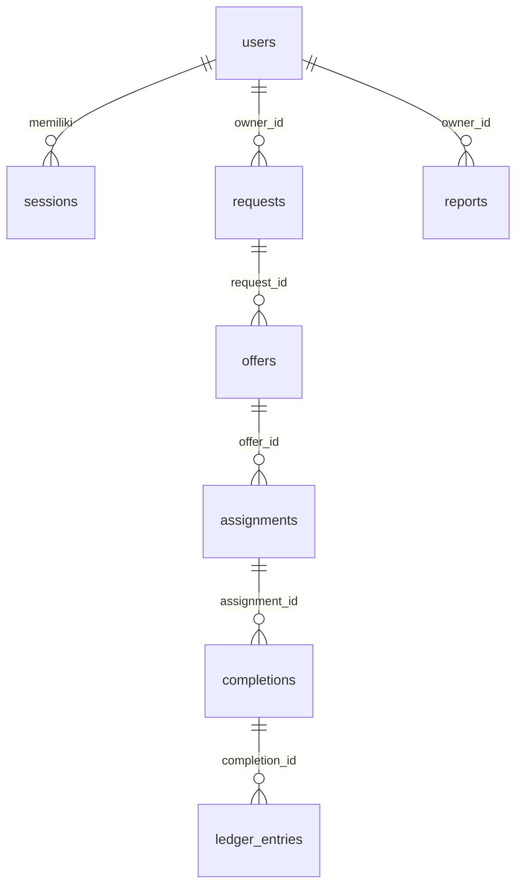

# Skema Database (Cloudflare D1)

> Status: Draft
> Terakhir diperbarui: 2026-10-28
> Pemilik: _TBD_

Skema D1 (SQLite) untuk database `satu-alur-db`. Sumber kebenaran: `migrations/0001_init.sql`. Dokumen ini menggantikan isi [DATABASE_SCHEMA.md](DATABASE_SCHEMA.md) (desain lama WorkBuddy/PostgreSQL).

## Perbedaan dari Desain PostgreSQL

| Aspek | PostgreSQL (lama) | D1 / SQLite (baru) |
|-------|-------------------|--------------------|
| Kunci utama | `BIGINT GENERATED ALWAYS AS IDENTITY` | `INTEGER PRIMARY KEY AUTOINCREMENT` |
| `owner_id` | `DEFAULT auth.uid()` | `TEXT NOT NULL`, diisi Worker dari sesi |
| Isolasi data | Row Level Security | Tidak ada RLS; Worker menambahkan `owner_id = ?` pada setiap query ([21_BACKEND.md](21_BACKEND.md)) |
| Waktu | `TIMESTAMPTZ`, `DATE` | `TEXT` ISO 8601 UTC, default `strftime('%Y-%m-%dT%H:%M:%fZ','now')` |
| JSON | `JSONB` | `TEXT` berisi JSON (di-serialize/parse oleh Worker) |
| Array | `TEXT[]` (`photos_path`) | `TEXT` berisi JSON array |
| `NUMERIC` | presisi tetap | afinitas `NUMERIC` SQLite (bukan desimal presisi tetap) |

## Tabel Autentikasi

Tidak dapat diakses lewat `POST /api/db`.

### users

| Kolom | Tipe | Catatan |
|-------|------|---------|
| `id` | TEXT PK | UUID |
| `email` | TEXT NOT NULL UNIQUE | huruf kecil |
| `name` | TEXT | bawaan: bagian email sebelum `@` |
| `created_at` | TEXT NOT NULL | |

### sessions

| Kolom | Tipe | Catatan |
|-------|------|---------|
| `token_hash` | TEXT PK | SHA-256 hex dari bearer token |
| `user_id` | TEXT NOT NULL | FK `users(id)` ON DELETE CASCADE |
| `expires_at` | TEXT NOT NULL | 30 hari sejak dibuat |
| `created_at` | TEXT NOT NULL | |
| `is_staff` | INTEGER NOT NULL DEFAULT 0 | 1 = dibuat `POST /api/auth/staff-login` (migrasi 0007); satu-satunya sumber hak admin |

Indeks: `idx_sessions_user_id`, `idx_sessions_expires_at`.

### staff_accounts

Akun staf Kantor Satu Alur (migrasi 0007). Dikelola hanya lewat `npm run staff`; tidak pernah ada di whitelist `/api/db`.

| Kolom | Tipe | Catatan |
|-------|------|---------|
| `id` | INTEGER PK | |
| `username` | TEXT NOT NULL UNIQUE | `[a-z0-9._-]{3,32}` |
| `password_hash` | TEXT NOT NULL | `pbkdf2-sha256$<iterasi>$<salt>$<hash>` |
| `active` | INTEGER NOT NULL DEFAULT 1 | 0 = dinonaktifkan |
| `failed_attempts` | INTEGER NOT NULL DEFAULT 0 | direset saat login berhasil atau saat terkunci |
| `locked_until` | TEXT | terkunci 15 menit setelah 5 kali salah |
| `last_login_at` | TEXT | |
| `created_at` | TEXT NOT NULL | |

### otp_codes

| Kolom | Tipe | Catatan |
|-------|------|---------|
| `id` | TEXT PK | dipakai sebagai `verificationId` |
| `email` | TEXT NOT NULL | |
| `code_hash` | TEXT NOT NULL | SHA-256 hex dari `id:kode` |
| `attempts` | INTEGER NOT NULL DEFAULT 0 | maks 5 |
| `expires_at` | TEXT NOT NULL | 10 menit |
| `created_at` | TEXT NOT NULL | |

Indeks: `idx_otp_codes_email`. Baris kedaluwarsa dibersihkan saat `send-otp`.

## Tabel Domain

Semua tabel domain memiliki `owner_id TEXT NOT NULL` (indeks `idx_<tabel>_owner_id`) dan `created_at`. Kolom `id` dan `owner_id` tidak dapat diisi/diubah klien.

### requests

| Kolom | Tipe | Catatan |
|-------|------|---------|
| `id` | INTEGER PK AUTOINCREMENT | |
| `owner_id` | TEXT NOT NULL | |
| `customer_name` | TEXT NOT NULL | |
| `service_type` | TEXT NOT NULL | |
| `location` | TEXT | |
| `description` | TEXT | |
| `status` | TEXT NOT NULL DEFAULT `'draft'` | |
| `requested_at` | TEXT | Jadwal yang diminta klien (ISO); migrasi 0003 |
| `created_at` | TEXT NOT NULL | |

Catatan: tidak ada kolom `phone`, padahal formulir Permintaan mengirimkannya (R-015 di [10_RISK_REGISTER.md](10_RISK_REGISTER.md)).

### offers

| Kolom | Tipe | Catatan |
|-------|------|---------|
| `id` | INTEGER PK AUTOINCREMENT | |
| `owner_id` | TEXT NOT NULL | |
| `request_id` | INTEGER NOT NULL | FK `requests(id)` |
| `ai_proposal_json` | TEXT | JSON |
| `validated_price` | NUMERIC | |
| `validated_scope` | TEXT | |
| `status` | TEXT NOT NULL DEFAULT `'draft'` | |
| `created_at` | TEXT NOT NULL | |

### assignments

| Kolom | Tipe | Catatan |
|-------|------|---------|
| `id` | INTEGER PK AUTOINCREMENT | |
| `owner_id` | TEXT NOT NULL | |
| `offer_id` | INTEGER NOT NULL | FK `offers(id)` |
| `worker_name` | TEXT | |
| `scheduled_at` | TEXT | ISO 8601 |
| `status` | TEXT NOT NULL DEFAULT `'pending'` | |
| `created_at` | TEXT NOT NULL | |

### workers

| Kolom | Tipe | Catatan |
|-------|------|---------|
| `id` | INTEGER PK AUTOINCREMENT | |
| `owner_id` | TEXT NOT NULL | |
| `name` | TEXT NOT NULL | |
| `phone` | TEXT | |
| `address` | TEXT | |
| `skills` | TEXT | JSON array kunci keahlian, mis. `["ac","cleaning"]` |
| `lat` | REAL | Dari geocode(); boleh NULL |
| `lng` | REAL | Dari geocode(); boleh NULL |
| `zone` | TEXT | Dari geocode(); boleh NULL |
| `status` | TEXT NOT NULL DEFAULT `'active'` | `active` \| `inactive` |
| `created_at` | TEXT NOT NULL | |

### assignment_workers

Satu penugasan, banyak petugas.

| Kolom | Tipe | Catatan |
|-------|------|---------|
| `id` | INTEGER PK AUTOINCREMENT | |
| `owner_id` | TEXT NOT NULL | |
| `assignment_id` | INTEGER NOT NULL | FK `assignments(id)` |
| `worker_id` | INTEGER NOT NULL | FK `workers(id)` |
| `created_at` | TEXT NOT NULL | |

Unik pada (`assignment_id`, `worker_id`).

### completions

| Kolom | Tipe | Catatan |
|-------|------|---------|
| `id` | INTEGER PK AUTOINCREMENT | |
| `owner_id` | TEXT NOT NULL | |
| `assignment_id` | INTEGER NOT NULL | FK `assignments(id)` |
| `notes` | TEXT | |
| `photos_path` | TEXT | JSON array string; belum dipakai UI |
| `status` | TEXT NOT NULL DEFAULT `'pending'` | |
| `completed_at` | TEXT | |
| `created_at` | TEXT NOT NULL | |

### ledger_entries

| Kolom | Tipe | Catatan |
|-------|------|---------|
| `id` | INTEGER PK AUTOINCREMENT | |
| `owner_id` | TEXT NOT NULL | |
| `completion_id` | INTEGER NOT NULL | FK `completions(id)` |
| `amount` | NUMERIC NOT NULL | |
| `category` | TEXT NOT NULL | lihat nilai di bawah |
| `status` | TEXT NOT NULL DEFAULT `'pending'` | |
| `posted_at` | TEXT | |
| `created_at` | TEXT NOT NULL | |

### reports

| Kolom | Tipe | Catatan |
|-------|------|---------|
| `id` | INTEGER PK AUTOINCREMENT | |
| `owner_id` | TEXT NOT NULL | |
| `period_start` | TEXT NOT NULL | tanggal |
| `period_end` | TEXT NOT NULL | tanggal |
| `summary_json` | TEXT | JSON |
| `explanation_html` | TEXT | |
| `status` | TEXT NOT NULL DEFAULT `'draft'` | |
| `created_at` | TEXT NOT NULL | |

## Nilai Enum (diberlakukan di aplikasi, bukan CHECK constraint)

| Entitas | Nilai |
|---------|-------|
| requests.status | `draft`, `submitted` |
| offers.status | `draft`, `pending_approval`, `approved`, `rejected` |
| assignments.status | `pending`, `assigned`, `in_progress`, `done` (kode di `domain/models.js` tidak mencantumkan `done`, tetapi stage Penyelesaian memakainya) |
| completions.status | `pending`, `done`, `issue` |
| ledger_entries.status | `pending`, `posted` |
| ledger_entries.category | `pendapatan`, `biaya_tenaga`, `biaya_bahan`, `biaya_transport`, `biaya_lain` |
| reports.status | `draft`, `final` |

## Relasi

Catatan: `owner_id` pada tabel domain tidak dideklarasikan sebagai foreign key ke `users` di migrasi; konsistensinya dijaga Worker.

## Tabel Publikasi Meta dan Kantor (migrasi `0007_social_meta.sql`)

| Tabel | Isi | Akses |
|-------|-----|-------|
| `social_accounts` | Satu Halaman Facebook per bisnis (`owner_id` PK): `page_id`, `page_name`, `page_token_enc` (AES-GCM), `ig_user_id`, `ig_username`, `needs_reconnect`, `connected_at` | Tidak ada di whitelist `/api/db`; hanya lewat `/api/social/*` |
| `social_oauth_picks` | Pilihan Halaman yang tertunda setelah OAuth (lebih dari satu Halaman): `id` (32 hex), `owner_id`, `blob` (daftar Halaman + token, AES-GCM), `expires_at` (10 menit). Dihapus saat dipakai; baris kedaluwarsa dibersihkan saat callback berikutnya | Tidak ada di whitelist `/api/db`; hanya lewat `/api/social/oauth/*` |
| `social_posts` | Satu baris per platform per terbit/jadwal: `content_id`, `platform`, `content`, `image_key`, `page_id`, `scheduled_at`, `status` (`scheduled`, `publishing`, `posted`, `failed`, `cancelled`), `platform_post_id`, `permalink`, `error`, `attempts`, `published_at`, `claimed_at`. Indeks `owner_id` dan `(status, scheduled_at)` | Baca-saja lewat `/api/db`; tulis lewat `/api/social/*` dan cron |
| `influencers` | Katalog global: `name`, `photo_key`, `niche`, `city`, `ig_followers`, `tiktok_followers`, `bio`, `visible` | Hanya lewat `/api/office/*`; tulis oleh admin |
| `service_requests` | Permintaan bisnis ke kantor: `kind` (`collab`/`ads`), `influencer_id`, `payload_json`, `status` (`new`/`in_progress`/`done`), `admin_note`, `updated_at`. Indeks `owner_id` | Hanya lewat `/api/office/*` |

Migrasi ini juga menambah `social_contents.image_key`. `social_schedules` tidak berubah: tetap pengingat bebas tahap "Media sosial" dan tidak pernah diproses cron.

## Migrasi

- Berkas: `migrations/0001_init.sql` (memakai `CREATE TABLE IF NOT EXISTS`).
- Lokal: `npm run db:migrate:local`; remote: `npm run db:migrate:remote`.
- Perubahan skema: tambahkan berkas bernomor berikutnya, dan perbarui whitelist di `worker/index.js` bila kolom/tabel domain berubah ([21_BACKEND.md](21_BACKEND.md)).
- Kebijakan retensi data, backup, dan ukuran batas D1: _TBD_.
