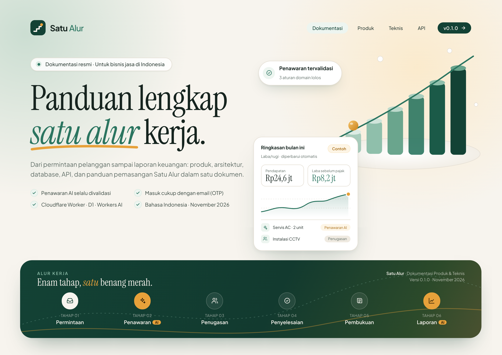

# Cover Dokumentasi

Cover resmi untuk dokumen Satu Alur. Gayanya mengikuti landing page: logo tangga hijau, kanvas krem, aksen kunyit, dan judul huruf serif.

| Orientasi | PNG | PDF (A4) |
|-----------|-----|----------|
| Landscape | [cover-landscape.png](cover-landscape.png) | [cover-landscape.pdf](cover-landscape.pdf) |
| Potret | [cover-portrait.png](cover-portrait.png) | [cover-portrait.pdf](cover-portrait.pdf) |



## Mengubah cover

Sumber HTML ada di `source/`. Ubah teks (judul, versi, tanggal) di file HTML, lalu render ulang:

```bash
node docs/cover/source/render.cjs
```

Skrip membutuhkan Playwright dengan Chromium dan koneksi internet untuk font Google (Plus Jakarta Sans, Instrument Serif). Angka di kartu "Ringkasan bulan ini" adalah contoh dari landing page, bukan data asli.
