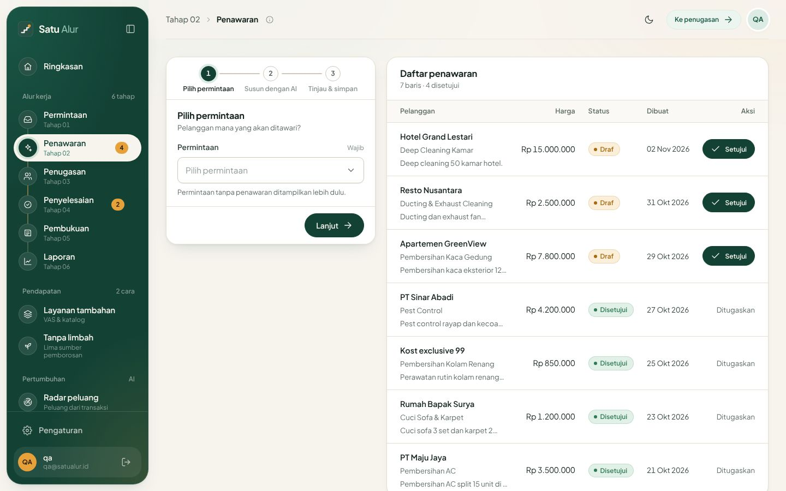
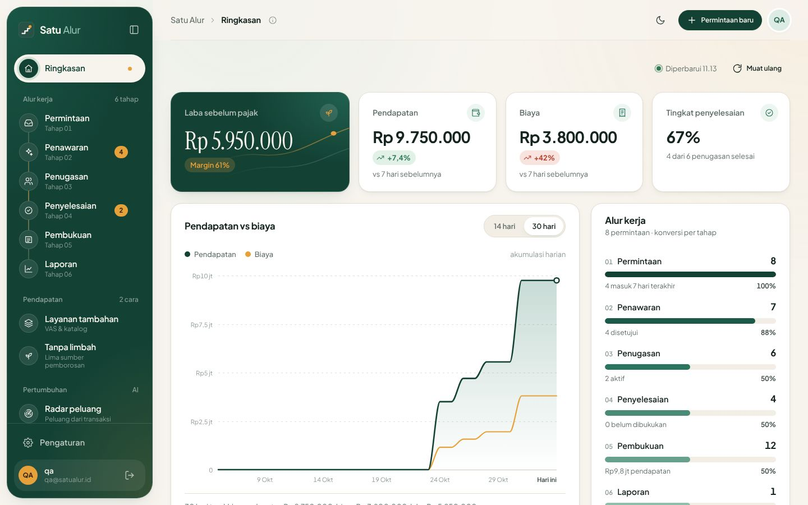
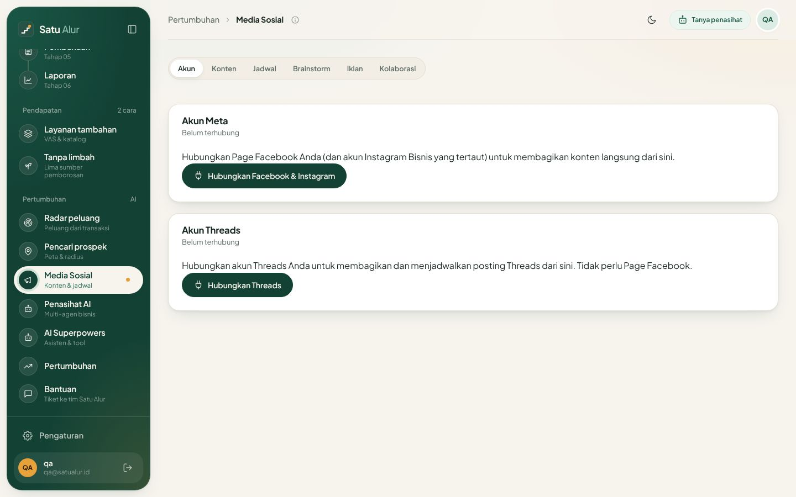
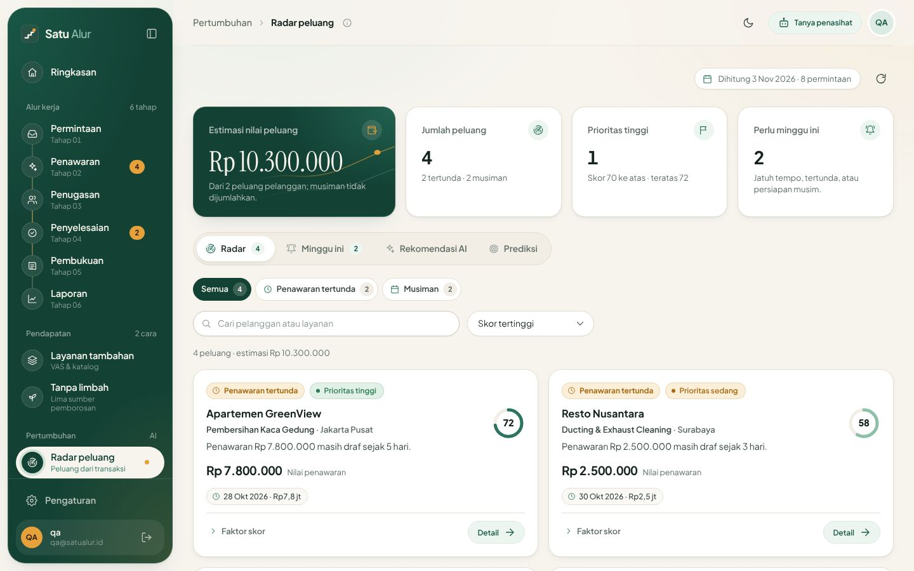
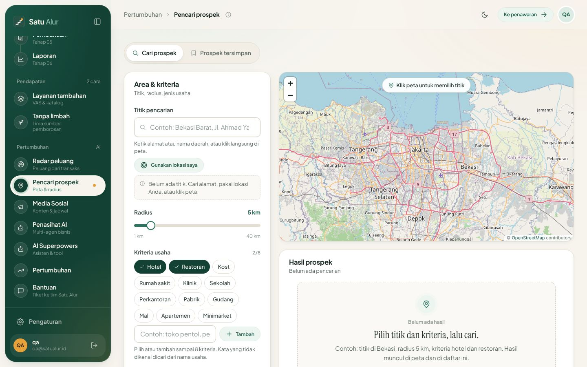
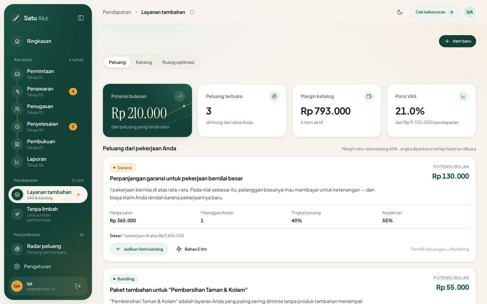
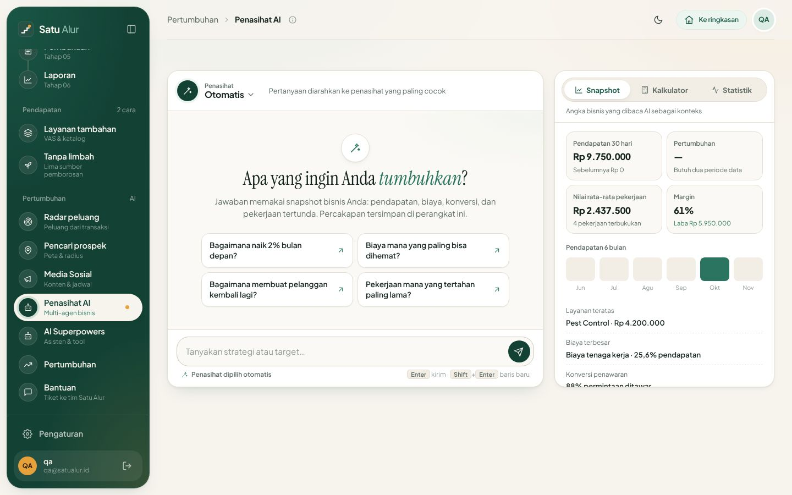

# Satu Alur — Dokumen Submission

> Status: Draf submission lomba (batas kirim 7 November 2026)
> Terakhir diperbarui: 2026-11-03
> Tim: Syahdan · Zulfikar · Margareta Lola
> Demo: <https://satu-alur.apipedia.workers.dev>  
> Video demo: <https://youtu.be/seXJmshTh0U>

**Satu Alur** adalah sistem kerja berbasis AI untuk bisnis jasa di Indonesia. Permintaan pelanggan, penawaran, penugasan, penyelesaian, pembukuan, dan laporan berjalan dalam **satu alur**. Setelah alurnya rapi, dua mesin lain ikut bekerja: **mesin pendapatan** (layanan tambahan dan tanpa limbah) dan **mesin pertumbuhan** (radar peluang, pencari prospek, media sosial, penasihat AI).

Semua angka di tangkapan layar berasal dari **data demo fiktif**. Kami belum mengklaim pelanggan, pendapatan, atau metrik penggunaan.

---

## 1. Ringkasan eksekutif

- **Masalah.** Pemilik usaha jasa (servis AC, cleaning, pest control, laundry, facility management) mengelola kerja di chat, catatan, dan spreadsheet yang terpisah. Penawaran lambat dan tidak konsisten. Laba baru terlihat di akhir bulan. Peluang dari pelanggan lama hilang tanpa disadari.
- **Solusi.** Satu aplikasi web yang menjalankan enam tahap kerja dari permintaan sampai laporan. AI bekerja di setiap tahap yang memang butuh penalaran: menyusun penawaran, menjelaskan laporan, membaca peluang, menilai prospek, menulis konten, dan memberi saran bisnis.
- **Pembeda utama.** AI dipakai sebagai **tangan yang membantu**, bukan kotak hitam. Penawaran AI selalu diperiksa aturan domain sebelum disimpan. Setiap peluang menampilkan buktinya dari transaksi pengguna. Data prospek hanya dari sumber yang sah.
- **Status.** Aplikasi sudah berjalan di Cloudflare (Workers + D1 + Workers AI) dengan 9 akun demo dari tiga skala usaha (perorangan, UKM, enterprise). Tersedia juga panel super-admin "Kantor Satu Alur", konektor ERP, dan lebih dari 400 unit test.

## 2. Masalah dan target pasar

**Target pengguna:** usaha jasa di Indonesia yang bekerja berdasarkan permintaan dan kunjungan lapangan.

| Skala | Contoh (akun demo, fiktif) | Kebutuhan utama |
|---|---|---|
| Perorangan | Servis AC Bekasi, home cleaning Makassar, listrik Medan | Penawaran cepat, catatan rapi, tahu laba |
| UKM | Pest control Surabaya, laundry Bandung, pengecatan Balikpapan | Penugasan tim, pembukuan per pekerjaan, pertumbuhan |
| Enterprise | Layanan ritel mal, facility management kantor, housekeeping rumah sakit | Integrasi sistem lama, laporan, kontrol biaya |

**Masalah yang kami pecahkan:**

1. **Kerja tercecer.** Permintaan masuk lewat chat, penawaran ditulis manual, pembukuan di spreadsheet. Tidak ada satu sumber kebenaran.
2. **Penawaran lambat dan tidak konsisten.** Harga dan ruang lingkup bergantung pada ingatan pemilik.
3. **Laba tidak terlihat.** Biaya per pekerjaan jarang dicatat, sehingga margin baru diketahui di akhir bulan, kalau diketahui.
4. **Pendapatan bocor.** Layanan tambahan tidak ditawarkan, sementara waktu menganggur, perjalanan, bahan, dan pekerjaan ulang menggerus laba.
5. **Pertumbuhan menebak-nebak.** Pelanggan yang seharusnya servis ulang terlupa, dan pencarian pelanggan baru dilakukan tanpa data.

## 3. Solusi dan cakupan

Cakupan disusun dalam dua lapis: **Aplikasi Office** (yang dipakai pengguna setiap hari) dan **Teknologi Pendukung**.

### 3.1 Aplikasi Office

#### Operasional — permintaan sampai laporan

| Tahap | Yang dilakukan | Peran AI |
|---|---|---|
| 01 Permintaan | Mencatat kebutuhan pelanggan di satu tempat; status mengikuti posisi di alur | — |
| 02 Penawaran | Wizard 3 langkah: pilih permintaan, susun dengan AI, tinjau dan simpan; tombol Setujui | **Agen penawaran** menyusun ruang lingkup, harga, ketentuan; **aturan domain** memvalidasi sebelum disimpan |
| 03 Penugasan | Menetapkan petugas dan jadwal untuk penawaran yang disetujui | — |
| 04 Penyelesaian | Menutup pekerjaan; satu penugasan hanya bisa diselesaikan sekali | — |
| 05 Pembukuan | Jurnal pendapatan dan biaya per pekerjaan; saldo berjalan; pendapatan tidak bisa diposting ganda | — |
| 06 Laporan | Laporan per periode dengan pembanding periode sebelumnya | **Agen laporan** menjelaskan angka dan memberi rekomendasi; jawaban mengalir langsung dan bisa dihentikan |




Monitoring proses tersedia di **Ringkasan**: laba sebelum pajak, pendapatan, biaya, tingkat penyelesaian, grafik pendapatan vs biaya, dan konversi per tahap.




#### Marketing — Media Sosial

- Menulis konten per platform (Instagram, TikTok, Facebook, Threads, LinkedIn, WhatsApp, X) dengan batas karakter dan hashtag masing-masing.
- Kalender jadwal unggah, bank ide, rencana iklan Meta, dan kolaborasi influencer.
- Publikasi ke Meta dan Threads lewat aplikasi resmi platform. Fitur ini aktif setelah kredensial aplikasi Meta/Threads diisi; tanpa itu, posting tetap manual.
- **Agen konten** menulis draf. Semua draf bisa diedit sebelum disimpan atau dijadwalkan.




#### Business Analyst — Radar Peluang dan Pencari Prospek

- **Radar Peluang** membaca transaksi pengguna sendiri. Ia menemukan layanan rutin yang jatuh tempo, pelanggan yang mulai menghilang, kandidat paket berkala, penawaran yang tertahan, dan musim ramai. Setiap peluang punya skor dan **faktor skor** yang bisa diperiksa. **Agen analis peluang** memberi rekomendasi tindakan.
- **Pencari Prospek** mencari usaha di sekitar titik dan radius pilihan di peta (Leaflet + OpenStreetMap). **Agen penilai prospek** menilai kecocokan dengan layanan pengguna dan membantu menyusun draf penawaran. Data diambil dari **sumber sah**: OpenStreetMap, dan Google Places API resmi bila kuncinya diisi. Kami **tidak** melakukan scraping Google Maps. Tidak ada pesan yang dikirim otomatis ke prospek.






#### Business Expansion & Growth — VAS dan Tanpa Limbah

Pendapatan punya dua tuas: menaikkan yang masuk, dan menutup yang bocor.

- **Layanan tambahan (VAS).** Menemukan potensi pendapatan tambahan yang sudah tersirat di pekerjaan pengguna, misalnya perpanjangan garansi atau paket bundling, lengkap dengan nilai Rupiah dan baris data yang menghasilkannya. Juga mengelola katalog VAS dengan margin.
- **Tanpa limbah (zero waste).** Mengukur kebocoran dalam Rupiah di lima aliran: waktu teknisi menganggur, perjalanan dan bahan bakar, bahan dan consumables, pekerjaan ulang dan panggilan balik, serta air dan bahan kimia. Temuan dicatat dan kemajuan menuju nol dipantau.
- **Ruang optimasi lima tim.** Satu brief dikerjakan paralel oleh Tim Kreatif, Tim Marketing, Tim Keuangan, Tim Operasional, dan Tim Riset & Data. **Pimpinan Optimasi** lalu menggabungkan jawabannya menjadi satu rencana.




#### Executive — Penasihat AI dan AI Superpowers

- **Penasihat AI** terdiri dari lima penasihat: Konsultan bisnis, Analis keuangan, Strategi pertumbuhan, Pemasaran, dan Operasional. Pertanyaan diarahkan otomatis ke penasihat yang paling cocok. Setiap jawaban memakai snapshot bisnis pengguna: pendapatan, margin, layanan teratas, biaya terbesar, dan konversi. Tersedia juga kalkulator dan statistik.
- **AI Superpowers** adalah asisten dengan memori, pemanggilan tool, dan percobaan ulang otomatis untuk tugas bisnis yang lebih luas.




### 3.2 Kantor Satu Alur (super-admin)

Panel khusus staf Satu Alur, terpisah dari akun pengguna:

- **Konten situs.** CMS landing page, halaman Tentang kami, dan dokumen legal.
- **Bisnis.** Paket langganan (Free / Lite / Pro) dan pengaturan payment gateway (Midtrans/Xendit).
- **Pelanggan.** Pelanggan dan mitra, pengguna, pesan Contact Us, dan tiket pengaduan CS.
- **Agensi influencer.** Profil influencer dengan rate card, permintaan kolaborasi atau iklan, dan kampanye beserta deliverable.

### 3.3 Teknologi pendukung

| Komponen | Status |
|---|---|
| **Multi-agentic AI di setiap proses** | Aktif. Agen penawaran, laporan, analis peluang, penilai prospek, konten, lima penasihat, lima tim optimasi + pimpinan |
| **Konektor ERP dan migrasi database (enterprise)** | Aktif untuk paket Enterprise. Tarik data REST/JSON, unggah CSV/JSON, dan webhook ber-HMAC. Pemetaan kolom dengan transformasi (Rupiah, tanggal, telepon Indonesia). Migrasi bertahap dengan *dry run* dan *rollback*. Panduan setup tersedia untuk Odoo, SAP B1, NetSuite, Accurate, dan Mekari |
| **Konektor Customer Service WhatsApp (WAPilot)** | Pengaturan konektor tersedia. Pengiriman otomatis dari server **dalam pengembangan** |

Catatan istilah: "MCP" di proyek ini adalah nama internal modul konektor ERP (REST `/api/mcp/*`), bukan implementasi standar Model Context Protocol.

## 4. Arsitektur dan teknologi

```
Browser (Vite + JavaScript, responsif desktop dan HP)
   │  HTTPS same-origin
   ▼
Cloudflare Worker  ──►  Workers AI (Llama 3.3 70B / 3.1 8B, streaming SSE)
   │  /api/auth  /api/db  /api/llm  /api/leads  /api/mcp  /api/office
   ▼
Cloudflare D1 (SQLite)  ·  aset statis di Workers Assets
```

| Lapisan | Pilihan | Alasan |
|---|---|---|
| Frontend | Vite, JavaScript modul, desain sistem "Tumbuh" (krim, hijau hutan, kunyit), Three.js untuk landing dan login | Ringan, cepat dibuka di HP, tanpa framework berat |
| Backend | Satu Cloudflare Worker | Satu deploy untuk aset dan API, dekat dengan pengguna Indonesia |
| Data | Cloudflare D1 | SQL terkelola, biaya awal nol, setiap baris dibatasi pemilik (`owner_id`) |
| AI | Workers AI; mode JSON terstruktur dengan parser toleran | Biaya rendah, output penawaran bisa divalidasi |
| Peta | Leaflet + OpenStreetMap; Nominatim/Overpass; Google Places opsional | Legal, tanpa scraping |
| Mutu | 400+ unit test (`node:test`) dan suite e2e Playwright | Setiap rilis diuji alur nyata |

**Keamanan dan privasi:**
- Login OTP email, dengan token sesi disimpan sebagai hash.
- Whitelist tabel dan kolom di endpoint data.
- Setiap query dibatasi ke pemilik data.
- Kredensial ERP dienkripsi dan tidak pernah dikirim balik ke browser.
- Teks AI disaring sebelum ditampilkan, jadi aman dari XSS.

## 5. Model bisnis (rencana)

| Paket | Harga (rencana) | Isi |
|---|---|---|
| Free | Rp0 | Seluruh alur kerja, dengan kuota percobaan AI per fitur |
| Lite | Rp99.000 / bulan | Kuota AI lebih besar untuk tim kecil |
| Pro | Rp249.000 / bulan | Kuota AI besar, fitur pertumbuhan penuh |
| Enterprise | Rp3.512.172 / bulan (kontrak, lewat "Hubungi kami") | Semua fitur Pro dengan kuota AI lebih besar, ditambah NDA (perjanjian kerahasiaan) dan SLA (uptime 99,9%, respons dukungan maks. 4 jam kerja) |

- **Saldo AI terpisah dari paket.** Membeli paket tidak termasuk saldo AI. Setelah kuota bulanan habis, pemakaian AI memotong saldo.
- **Voucher tiga jenis** untuk peluncuran: voucher paket (misalnya Pro 30 hari), voucher saldo AI (misalnya Rp50.000), dan voucher gabungan. Setiap penukaran tercatat sebagai data calon pelanggan; voucher bernilai besar lewat "Hubungi kami".
- **Pendapatan kedua:** agensi pemasaran digital lewat iklan Meta dan agregator influencer, dikelola dari Kantor Satu Alur.

Kuota per fitur dan voucher sudah dirancang dan diimplementasikan dalam branch terpisah (**dalam pengembangan**, menunggu review sebelum masuk rilis).

## 6. Rencana go-to-market

- **Soft launch:** rencana tampil di panggung komunitas Garuda Spark, Surabaya (sedang dijajaki).
- **Pelanggan awal:** pendekatan langsung ke jaringan pemilik usaha jasa, termasuk pengguna ERP yang sudah ada, dengan imbal balik testimoni dan logo pelanggan.
- **Domain dan identitas:** domain produk sedang dipilih (prioritas: singkat, mudah diingat, TLD).
- **Kemitraan:** penjajakan kolaborasi dengan penyedia software akuntansi lokal setelah produk stabil (belum ada kesepakatan).

## 7. Product sharing: peran WorkBuddy dalam pembuatan

### Bahasa Indonesia

Satu Alur **lahir di WorkBuddy**. Prototipe pertama dibangun langsung di WorkBuddy dengan **WorkBuddy Cloud SDK** untuk autentikasi dan database, serta **AI connect** untuk LLM tanpa perlu mengelola kunci API. Dalam satu sesi kerja, kami bisa membuktikan alur enam tahap dari permintaan sampai laporan, lengkap dengan penawaran AI yang berjalan.

Nilai tambah terbesar WorkBuddy bagi kami:

1. **Dari ide ke prototipe yang bisa diklik dalam hitungan jam.** Tim tidak perlu menyiapkan server, database, atau kunci AI sebelum bisa menguji ide di depan calon pengguna.
2. **AI connect tanpa kunci.** Kami bisa bereksperimen dengan prompt penawaran dan laporan sejak hari pertama, lalu fokus pada aturan domain yang memvalidasi output AI.
3. **Kontrak data yang jelas.** Antarmuka SDK bergaya query builder menjadi pola yang kami pertahankan saat produk dipindahkan ke Cloudflare. Mode mock, backend HTTP, dan kode tahap tetap memakai antarmuka yang sama.

Saat produk bertambah besar, kami memindahkan runtime ke Cloudflare Workers + D1 + Workers AI agar siap production: domain sendiri, kontrol biaya, dan migrasi skema. WorkBuddy AI connect tetap kami pakai untuk demo lomba. Pola kerjanya: WorkBuddy untuk kecepatan eksplorasi, infrastruktur terkelola untuk produksi.

### English

Satu Alur **was born in WorkBuddy**. We built the first prototype inside WorkBuddy, using the **WorkBuddy Cloud SDK** for auth and data and **AI connect** for keyless LLM access. Within a single working session we had a clickable six-stage flow, from customer request to report, with a working AI quotation step.

Where WorkBuddy added the most value:

1. **Idea to clickable prototype in hours.** No servers, databases or API keys to provision before we could put the idea in front of real service-business owners.
2. **Keyless AI from day one.** We iterated on the quotation and report prompts immediately and spent our energy on the domain rules that validate AI output.
3. **A clean data contract.** The SDK's query-builder interface became the pattern we kept when we moved to Cloudflare. Our mock backend, HTTP backend and every stage still speak the same interface.

As the product grew we moved the runtime to Cloudflare Workers + D1 + Workers AI for production needs: our own domain, cost control and schema migrations. WorkBuddy AI connect remains our engine for the competition demo. The pattern we learned: WorkBuddy for exploration speed, managed infrastructure for production.

## 8. Key insight & learning

### Bahasa Indonesia

1. **AI harus bisa diperiksa, bukan sekadar pintar.** Pengguna UKM baru percaya pada harga dari AI setelah aturan domain memvalidasinya dan buktinya terlihat. Karena itu setiap peluang di radar menampilkan faktor skor, dan setiap penawaran melewati validasi sebelum disimpan.
2. **Output terstruktur mengalahkan prompt panjang.** Masalah terbesar awal adalah JSON AI yang rusak. Mode JSON berskema ditambah parser toleran dan normalisasi menyelesaikannya, jauh lebih efektif daripada memperpanjang instruksi.
3. **Biaya adalah fitur.** Kuota tulis D1 gratis (100 ribu baris per hari) pernah habis oleh seed data demo. Dari situ kami belajar menghitung biaya per operasi: menghapus indeks yang tidak dipakai, memakai *keyset paging*, membuat seed versi ringan, dan menyimpan riwayat chat di perangkat.
4. **Legal sejak hari pertama.** Pencari prospek memakai OpenStreetMap dan API resmi, bukan scraping. Kecepatannya sedikit kalah, tapi produk bisa dijual tanpa risiko hukum.
5. **Sederhanakan layar.** Masukan tim mengubah halaman panjang menjadi wizard, menambah paginasi, dan memindahkan penjelasan halaman ke tooltip. Pengguna di HP merasakan bedanya.
6. **Kerja tim manusia + agen AI.** Tiga orang dengan peran jelas (engineering, produk, QA) ditambah agen coding yang bekerja paralel bisa menghasilkan produk sebesar ini dalam sekitar satu minggu, asalkan setiap perubahan diuji otomatis.

### English

1. **AI must be checkable, not just clever.** Small-business owners trust an AI price only when domain rules have validated it and the evidence is visible. Every radar opportunity shows its scoring factors, and every quotation is validated before it is saved.
2. **Structured output beats longer prompts.** Our biggest early failure was malformed AI JSON. Schema-constrained JSON mode plus a tolerant parser and normalisation fixed it far better than longer instructions did.
3. **Cost is a feature.** Seeding demo data once exhausted D1's free write quota (100k rows/day). We learned to budget writes per operation: dropping unused indexes, keyset paging, a lean seed, and keeping chat history on the device.
4. **Legal from day one.** The lead finder uses OpenStreetMap and official APIs, never Google Maps scraping. It is slightly slower, but we can sell it without legal risk.
5. **Simplify the screen.** Team feedback turned long pages into wizards, added pagination, and moved page explanations into tooltips. Mobile users notice the difference.
6. **Humans plus AI agents.** Three people with clear roles (engineering, product, QA), working with parallel coding agents, shipped this scope in about a week, because every change was covered by automated tests.

## 9. Tim

| Nama | Peran | Kontribusi utama |
|---|---|---|
| **Syahdan** | CTO, engineering | Port ke Cloudflare Workers + D1 + Workers AI, desain sistem "Tumbuh", alur enam tahap, radar peluang, pencari prospek, penasihat AI, optimasi biaya D1, deploy |
| **Zulfikar** | Produk dan fitur | Media sosial dan publikasi Meta/Threads, Kantor Satu Alur (super-admin), agensi influencer, VAS dan Tanpa limbah, konektor ERP, materi pemasaran |
| **Margareta Lola** | QA dan audit | Lebih dari 190 test case UAT, audit ekonomi data demo, pengujian dan laporan bug lintas fitur |

## 10. Roadmap

| Tahap | Rencana |
|---|---|
| Sekarang | Rilis lomba: alur enam tahap, mesin pendapatan, mesin pertumbuhan, Kantor Satu Alur, konektor ERP |
| Berikutnya | Kuota per fitur dan voucher, pembayaran online paket dan saldo AI, onboarding dan tur fitur, email OTP produksi |
| Lanjutan | Notifikasi WhatsApp otomatis lewat WAPilot, sinkronisasi ERP dua arah, aplikasi petugas lapangan, indikator ekonomi BPS untuk radar |

## 11. Akses demo

1. Buka <https://satu-alur.apipedia.workers.dev>.
2. Klik **Masuk**, pilih **Akun demo**, pilih skala usaha (Sole Trader, UKM, atau Enterprise), lalu pilih salah satu dari 9 akun.
3. Atau masuk dengan email apa pun. Pada mode demo, kode OTP ditampilkan langsung di layar.

Video demo (2:48, dengan narasi): <https://youtu.be/seXJmshTh0U>

Semua data akun demo adalah **data fiktif** untuk keperluan demonstrasi.

## Lampiran A — Daftar fitur

| Kelompok | Halaman |
|---|---|
| Alur kerja | Ringkasan, Permintaan, Penawaran, Penugasan, Penyelesaian, Pembukuan, Laporan |
| Pendapatan | Layanan tambahan (Peluang, Katalog, Ruang optimasi), Tanpa limbah (Pemborosan, Tindakan, Ruang optimasi) |
| Pertumbuhan | Radar peluang, Pencari prospek, Media Sosial, Penasihat AI, AI Superpowers, Pertumbuhan |
| Bantuan | Tiket ke tim Satu Alur |
| Pengaturan | Konektor (WhatsApp, Email), Agen AI (prompt dan parameter), integrasi ERP |
| Kantor Satu Alur | Landing page, Tentang kami, Legal, Paket langganan, Payment gateway, Pelanggan & mitra, Pengguna, Contact Us, Pengaduan CS, Influencer, Permintaan, Kampanye |

## Lampiran B — Cara menguji di lokal

```bash
git clone https://github.com/maszulfikarsuweleh/satu-alur.git
cd satu-alur
npm install
npm run dev          # http://localhost:5173, mode demo: data contoh di browser, AI disimulasikan
npm test             # unit test + e2e Playwright
```

Untuk menguji dengan Worker, D1, dan AI sungguhan di lokal: `npm run db:migrate:local`, lalu `npm run cf:dev` (http://localhost:8787).
